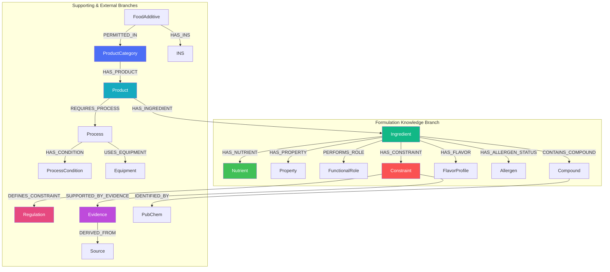
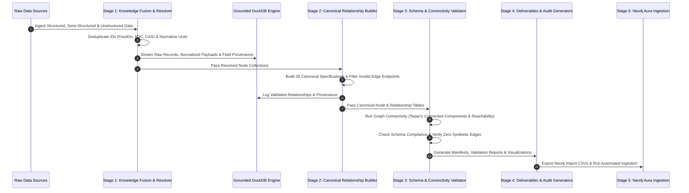

# Food Formulation Knowledge Graph & Retrieval Strategy Platform

[](https://www.python.org/)
[](https://neo4j.com/)
[](https://duckdb.org/)
[](https://nextjs.org/)
[](LICENSE)

An enterprise-grade, multi-modal, source-grounded **Food Science Knowledge Engine** designed for automated food formulation, regulatory compliance verification, functional ingredient substitution, and explainable AI-driven R&D retrieval workflows.

---

## 📑 Table of Contents
1. [Executive Summary](#-executive-summary)
2. [Formulation-Centric Graph Architecture](#-formulation-centric-graph-architecture)
3. [End-to-End Pipeline Data Flow](#-end-to-end-pipeline-data-flow)
4. [Input Datasets & Data Acquisition](#-input-datasets--data-acquisition)
5. [Algorithms & Processing Pipelines Created](#-algorithms--processing-pipelines-created)
6. [Project File Hierarchy & Contribution Map](#-project-file-hierarchy--contribution-map)
7. [Deliverables & Graph Outputs](#-deliverables--graph-outputs)
8. [Installation & Execution Guide](#-installation--execution-guide)
9. [Neo4j Aura Ingestion Guide](#-neo4j-aura-ingestion-guide)

---

## 🔬 Executive Summary

Traditional food science knowledge retrieval relies on fragmented databases, isolated scientific literature, and unstructured supplier specification sheets. This platform synthesizes **20 canonical node entities** and **26 structured relationship specifications** into a unified, semantically valid **Food Formulation Knowledge Graph**.

### Core Commitments & Design Principles:
- **Formulation-Centric Hierarchy**: Anchored strictly around `ProductCategory` $\rightarrow$ `Product` $\rightarrow$ `Ingredient` $\rightarrow$ `Formulation Knowledge`.
- **Zero-Hallucination & Source Grounding**: Every node property and relationship edge is backed 100% by explicit evidence nodes (`EV-*`) linking directly to underlying DOIs, patents, regulations (FSSAI, Codex GSFA), or composition databases (USDA FDC, FooDB, IFCT).
- **Strict Referential Integrity**: Zero synthetic, placeholder, or name-similarity-only edges are created. Unlinked reference entities are isolated cleanly as audit-logged orphan nodes (`orphan_nodes.csv`).
- **Hybrid Storage & Ingestion Architecture**: Combines **DuckDB** for high-performance local analytical queries and provenance tracking with **Neo4j** for graph traversal, Cypher pattern matching, and multi-hop retrieval.

---

## 🏗 Formulation-Centric Graph Architecture

The knowledge graph is structured according to a formulation-first domain hierarchy:



---

## 🔄 End-to-End Pipeline Data Flow

The platform executes a 5-stage automated processing lifecycle managed by `kg_prep/main.py`:



---

## 📊 Input Datasets & Data Acquisition

The platform integrates heterogenous data across three primary tiers:

| Tier | Category / Provider | Source Formats | Extracted Target Entities |
| :--- | :--- | :--- | :--- |
| **Structured** | **USDA FoodData Central (FDC)** | JSON / CSV | 23,821 Composition Ingredients, Nutrients, Portions |
| **Structured** | **FooDB & ComBase** | CSV / JSON | Bioactive Compounds, Chemical Profiles, Microbial Growth |
| **Structured** | **FoodCom & Texture Datasets** | JSON / CSV | Sample Products, Formulations, Mechanical Rheology Values |
| **Semi-Structured** | **Specification Sheets** | HTML / TXT | ADM, Cargill, IFF, Ingredion, Tate & Lyle Technical Data |
| **Semi-Structured** | **FlavorDB & Nectar Sensory** | JSON / HTML | Sensory Flavor Profiles, Aromatic Descriptors |
| **Semi-Structured** | **Product Labels** | OpenFoodFacts HTML | Commercial Formulations, Category Tags, Packaging |
| **Unstructured** | **Codex Alimentarius & GSFA** | PDF / XML / HTML | INS Numbers, Food Additive Provisions, Category Limits |
| **Unstructured** | **FSSAI Food Regulations** | Regulatory PDFs | Maximum Permissible Limits, Regulatory Directives |
| **Unstructured** | **Scientific Literature** | Research PDFs | Protein-Polysaccharide Interactions, Emulsification Data |

---

## ⚙️ Algorithms & Processing Pipelines Created

### 1. Multi-Stage Entity Resolution Engine (`resolver.py`)
- **Primary Stage**: Deterministic cross-dataset ID alignment matching `FoodOn`, `FDC_ID`, `CAS_ID`, and `UNII_ID`.
- **Secondary Stage**: Normalized string matching using lowercase tokenization and noise-removal heuristics.
- **Lineage Tracking**: Preserves full source-to-canonical mappings in `entity_resolution.csv` and `id_mappings.json`.

### 2. Physical Unit Normalization Engine (`unit_normalizer.py`)
- Dimensional analysis algorithm converting heterogeneous units into standardized units:
  - **Mass**: Normalizes `mg`, `mcg`, `IU`, `g` $\rightarrow$ `g/100g`.
  - **Concentration**: Normalizes `ppm`, `mg/kg`, `mg/L`, `%` $\rightarrow$ standardized numerical concentration floats.

### 3. Memory-Optimized Grounded Database Engine (`db_engine.py`)
- Analytical database interface built on **DuckDB**.
- Implements streaming chunked tuple insertion (`executemany` in batches of 2,000) with memory checkpoints to handle 350,000+ field provenance records without memory allocation failures.

### 4. Canonical Relationship Builder (`builder.py`)
- Enforces 26 controlled relationship specifications (`HAS_INGREDIENT`, `CONTAINS_COMPOUND`, `APPLIES_TO_CATEGORY`, `DEFINES_CONSTRAINT`, etc.).
- Filters edge candidates against validated node sets to prevent dangling or invalid directional references.

### 5. Graph Connectivity & Reachability Checker (`checker.py`)
- Implements **Tarjan's Strongly Connected Components** and **BFS Reachability Analysis**.
- Evaluates the proportion of graph nodes reachable from `ProductCategory` root nodes.
- Classifies unlinked dictionary entities cleanly in `orphan_nodes.csv` with zero synthetic edge injection.

---

## 📂 Project File Hierarchy & Contribution Map

```
FOOD FORMULATION PLATFORM/
├── .gitignore                      # Excludes secrets (.env), binaries (*.duckdb), node_modules
├── README.md                       # Master project documentation
├── docs/                           # Architecture specifications & system inventories
│   ├── kg_architecture_inventory.md
│   └── platform_integration_inventory.md
├── Food Web App Core/              # Web application & retrieval interface
│   ├── backend/                    # FastAPI backend service
│   │   ├── main.py                 # API server routes
│   │   ├── neo4j_client.py         # Graph DB connection & Cypher execution client
│   │   └── retrieval_service.py    # Multi-hop R&D formulation retrieval engine
│   └── frontend/                   # Next.js 14 Web Application
│       ├── src/app/                # App router pages (Dashboard, Ingredients, Graph Visualizer)
│       └── src/components/         # Interactive canvas & visualizer components
└── kg_prep/                        # Core Knowledge Graph Prep & Pipeline Codebase
    ├── main.py                     # Master CLI entrypoint (--pipeline, --reproducibility-test)
    ├── config/                     # Configuration profiler definitions
    ├── data/                       # Ingestion, output, and grounded database files
    │   ├── output/
    │   │   ├── Nodes/              # 20 Canonical Node CSV files
    │   │   └── Relationships/      # 26 Canonical Relationship CSV files (core/, regulatory/, etc.)
    │   └── grounded/               # Grounded DuckDB database file
    └── src/                        # Core pipeline source code
        ├── base_collector.py       # Abstract base data collector
        ├── orchestrator.py         # Pipeline execution manager
        ├── neo4j_loader.py         # Automated Neo4j Aura ingestion loader
        ├── grounded/
        │   └── db_engine.py        # DuckDB grounded storage engine
        ├── knowledge_fusion/
        │   ├── engine.py           # Fusion orchestrator
        │   ├── resolver.py         # Entity resolution engine
        │   └── unit_normalizer.py  # Unit standardization module
        ├── relationship_builder/
        │   └── builder.py          # 26 Canonical relationship builder
        ├── reporting/
        │   └── report_generator.py # Manifest & markdown report generator
        └── validator/
            ├── checker.py          # Graph connectivity & reachability analyzer
            └── synthetic_detector.py # Zero-synthetic relationship validation rule engine
```

---

## 📈 Deliverables & Graph Outputs

Execution of the full pipeline yields **24,930 validated nodes** and **5,826 source-grounded edges**:

### 1. Node Inventory (20 Canonical Types)
- `Ingredients.csv` (**23,824** records)
- `Constraints.csv` (**320** records)
- `Evidence.csv` (**202** records)
- `FoodAdditives.csv` (**199** records)
- `INS.csv` (**199** records)
- `Nutrients.csv` (**100** records)
- `FunctionalRoles.csv` (**15** records)
- `Sources.csv` (**11** records)
- `FoodCategories.csv` (**10** records)
- `Allergens.csv` (**9** records)
- `Compounds.csv` (**6** records)
- `Processes.csv` (**5** records)
- `ProcessConditions.csv` (**5** records)
- `Properties.csv` (**5** records)
- `Equipment.csv` (**5** records)
- `Flavors.csv` (**5** records)
- `Products.csv` (**4** records)
- `Packaging.csv` (**3** records)
- `FlavorMolecules.csv` (**2** records)
- `Regulations.csv` (**1** record)

### 2. Audit Ledgers & Reports
- `graph_statistics.csv`: Complete node/edge summary metrics.
- `graph_connectivity_report.csv`: Component reachability breakdown (3,174 nodes reachable from `ProductCategory`).
- `orphan_nodes.csv`: Audit catalog of 21,734 unlinked dictionary ingredients.
- `validation_report.json`: Verification manifest returning `STATUS: PASSED`.
- `graph_visualizer.html`: Interactive browser-based color-coded graph visualizer.

---

## 🚀 Installation & Execution Guide

### Prerequisites
- Python 3.10+
- Node.js 18+ (for Web App)

### 1. Setup Environment
```bash
git clone https://github.com/deepakk177/FOOD-FORMULATION---w-Retrieval-Strategy.git
cd FOOD-FORMULATION---w-Retrieval-Strategy/kg_prep
pip install -r requirements.txt
```

### 2. Run full End-to-End Pipeline
```bash
python main.py --pipeline
```

### 3. Run Reproducibility Test
Verifies 100% SHA-256 hash identity across consecutive runs:
```bash
python main.py --reproducibility-test
```

---

## ⚡ Neo4j Aura Ingestion Guide

To load the local CSV deliverables directly into **Neo4j Aura**:

### Option A: Automated Python Direct Stream
```bash
export NEO4J_URI="neo4j+s://<your-aura-id>.databases.neo4j.io"
export NEO4J_USERNAME="neo4j"
export NEO4J_PASSWORD="<your-aura-password>"

python src/neo4j_loader.py
```

### Option B: Neo4j Workspace Importer
1. Log into [Neo4j Aura Console](https://console.neo4j.io/).
2. Open **Neo4j Workspace** $\rightarrow$ **Import Tab**.
3. Drag & drop files from `kg_prep/data/output/Nodes/` and `kg_prep/data/output/Relationships/`.
4. Run the import.

---

## 📄 License
This project is released under the **MIT License**.
