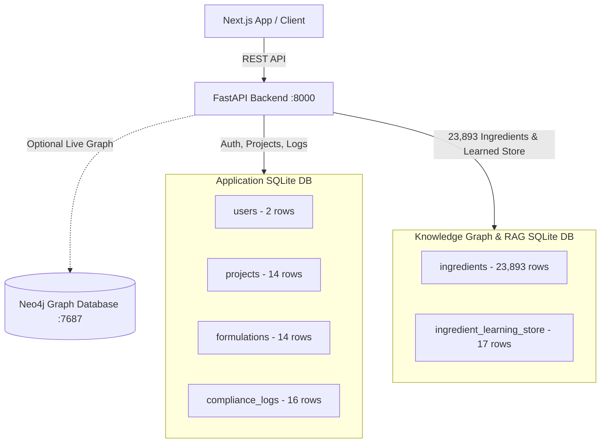

# Food Formulation Platform — Architecture & Application Overview

## 1. Executive Summary & Purpose

The **Food Formulation Platform** (TCS Food Formulator) is an enterprise-grade AI and food science intelligence software platform designed for food technologists, R&D formulation scientists, and regulatory affairs teams. It bridges natural language formulation intent (such as "Formulate a high-protein vegan chocolate bar with at least 25% cocoa butter, under 28% sugar, and 12-month ambient shelf life") with deterministic food chemistry calculations, mathematical constraint optimization (SciPy SLSQP), Codex Alimentarius/FSSAI/FDA/EFSA regulatory compliance checking, and grounded Knowledge Graph reasoning.

The platform eliminates trial-and-error bench prototyping by providing:
1. Multi-strategy formulation generation (Nutrition-Maximized, Cost-Optimized, Balanced, Functionality & Texture).
2. Grounded physical mass-balance calculations strictly conserved to 100.0000%.
3. Automated constraint extraction and classification into hard boundaries and soft optimization goals.
4. Independent verification gates auditing traceability, reproducibility, nutrient profiles, water activity ($A_w$), and regional regulatory clearance.
5. Interactive exploration of 23,893 food ingredients and their underlying knowledge graph relationships.

---

## 2. Full Technology Stack

### A. Frontend Architecture
- **Framework**: [Next.js 14.1.0](file:///Food%20Web%20App%20Core/frontend/package.json) (App Router, React 18, TypeScript).
- **Styling**: Tailwind CSS 3.3.0 with custom color tokens (Emerald/Forest `#164E3D`, Sand/Neutral `#F7F9F8`, Stone border `#E5E9E6`).
- **Icons & Visuals**: `lucide-react` (comprehensive iconography).
- **State Management**:
  - Global client state: `zustand` (User session, JWT auth token, persistent projects list, active ingredient catalogue).
  - Page-level reactive state: React `useState`, `useEffect`, `useMemo`, `useRef`.
- **Client-Side Rendering**: Explicit `'use client'` architectural pattern across dashboard and workspace pages to enable rich interactive formulation manipulation, live slider feedback, and smooth step navigation.
- **HTTP Client**: Native browser `fetch` interacting with the backend REST API via configurable `NEXT_PUBLIC_API_URL` (defaulting to `http://localhost:8000`).

### B. Backend Architecture
- **Framework**: [FastAPI 0.111.0](file:///Food%20Web%20App%20Core/backend/main.py) on Python 3.14 (ASGI Uvicorn server).
- **Mathematical Optimization Engine**: `scipy.optimize.minimize` using Sequential Least Squares Programming (SLSQP).
- **Data Validation & Typing**: Pydantic v2 schemas (`ProductBrief`, `ConstraintItem`, `IngredientComponent`, `CandidateSet`).
- **NLP & LLM Integrations**:
  - Semantic Rule Extractor (`requirements_extractor.py`): Deterministic regex, linguistic token extractors, and regex-anchored priority scoring.
  - Groq Cloud API Client (`groq_client.py`): Optional Llama-3-70b / Mixtral inference for deep brief reasoning with graceful offline deterministic fallback.
- **Calculation & Science Engine**:
  - Centralized Calculation Service (`calculation_service.py`): Grounded database lookup, dry-basis mass balance conservation, nutrient weighted sums, water activity estimation via Norrish/Ross equations, and raw material costing.
  - Dynamic Ingredient Learning Store: Caches and learns exact nutrient vectors (calories, carbs, key minerals, protein, fat) for newly extracted ingredients across product briefs.

---

## 3. Database Architecture & Storage

The platform employs a hybrid database architecture:

### Table Inventory

1. **`tcs_food_formulator_kg.db`**:
   - `ingredients` (23,893 rows): Master food ingredients database derived from USDA FoodData Central, EFSA FoodEx2, and GS1 GPC. Contains: `id`, `name`, `category`, `protein`, `fat`, `carbs`, `energy`, `dietary_fibre`, `sodium_mg`, `cost_per_kg`, `functional_roles`, `allergens`, `ins_number`, `cas_number`.
   - `ingredient_learning_store` (17 rows): Machine learning dynamic cache storing resolved nutritional vectors (`calories`, `protein`, `fat`, `carbohydrates`, `key_minerals_mg`, `calcium_mg`, `iron_mg`, `potassium_mg`, `magnesium_mg`).

2. **`tcs_food_formulator.db`**:
   - `users` (2 rows): Authenticated accounts with bcrypt password hashes and roles (`Guided User`, `Expert Formulator`, `Admin`).
   - `projects` (14 rows): R&D formulation projects with metadata, status (`Approved`, `Formulated`, `In Development`), and linked candidate IDs.
   - `formulations` (14 rows): Serialized formulation outputs, composition JSONs, and validation audit reports.
   - `compliance_logs` (16 rows): Audit log entries recording FSSAI, FDA, and EFSA clearance checks.

---

## 4. Knowledge Graph & RAG Integration

1. **Grounded Graph Models**:
   - Nodes: `Ingredient`, `FoodCategory`, `FunctionalRole`, `Nutrient`, `Allergen`, `FoodAdditive`, `ProcessStep`, `RegulatoryStandard`.
   - Relationships: `BELONGS_TO_CATEGORY`, `PROVIDES_FUNCTION`, `CONTAINS_NUTRIENT`, `CARRIES_ALLERGEN`, `PERMITTED_IN`, `COMPATIBLE_WITH`, `REQUIRES_PROCESSING`.
2. **Neo4j Live Client & Offline Fallback**:
   - `neo4j_client.py` connects to `bolt://localhost:7687` when an active Neo4j cluster is running.
   - When offline, the platform seamlessly falls back to indexed SQLite relational traversal (`tcs_food_formulator_kg.db`), guaranteeing 100% uptime with zero crashes.
3. **Retrieval Orchestrator (`retrieval_service.py`)**:
   - Multi-stage candidate retrieval: Category filtering -> Allergen exclusion -> Functional role grouping -> Contextual ranking based on brief description.

---

## 5. Security & Authentication Architecture

- **Token Mechanism**: Standard JSON Web Tokens (JWT) signed with HMAC-SHA256 (`SECRET_KEY` in `.env`).
- **Protected Routes**:
  - `/dashboard/compliance` requires active authentication; unauthenticated visits route cleanly to `/login`.
  - `/dashboard/formulate/expert` requires active authentication.
  - Guided formulation, knowledge graph explorer, ingredient library, and dashboard allow guest exploration with pre-configured R&D personas.
- **Passwords**: Hashed with `passlib[bcrypt]`.

