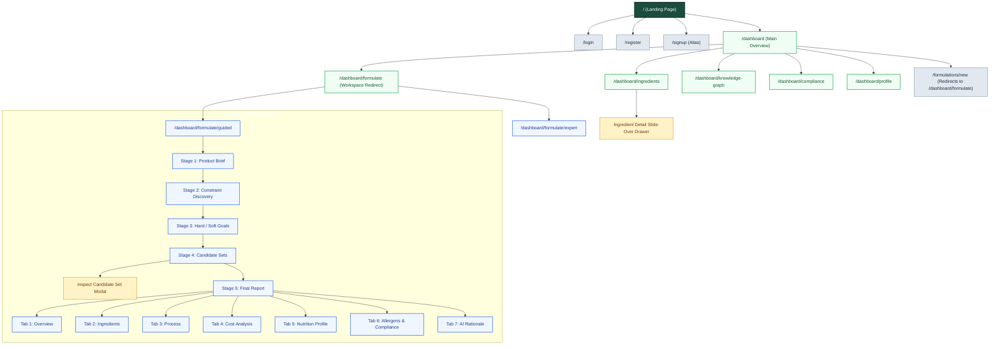

# Navigation Map — Food Formulation AI Platform

This document provides a hierarchical navigation map and structural routing diagram of the entire Food Formulation AI Platform, illustrating all parent routes, child pages, modal dialogs, slide-over panels, and analytical tabs.

---

## 1. Visual Application Sitemap (Mermaid Diagram)



---

## 2. Hierarchical Route Tree

```text
/ (Landing Page - Hero, Platform Capabilities, Value Proposition)
│
├── /login (User Authentication & JWT Issuance)
├── /register (New Account Creation & Organization Onboarding)
├── /signup (Functional alias to /register)
│
└── /dashboard (Platform Central Command & Analytics)
    │
    ├── /dashboard/formulate (Workspace Hub - Redirects to Active Formulation Flow)
    │   │
    │   ├── /dashboard/formulate/guided (Flagship 5-Stage Guided Formulation Wizard)
    │   │   ├── Stage 1: Product Brief Submission
    │   │   │   └── Presets: High-Protein Snack Bar, Plant Milk, Keto Cookie
    │   │   ├── Stage 2: Constraint Discovery & Entity Extraction
    │   │   │   ├── Nutritional Limits Editor
    │   │   │   ├── Physicochemical Boundaries (Aw, pH, Moisture)
    │   │   │   └── Infeasible Allergen Pruner
    │   │   ├── Stage 3: Hard / Soft Goals Prioritization
    │   │   │   ├── Hard Constraints (Binary Must-Haves)
    │   │   │   └── Soft Multi-Objective Priority Sliders (Cost, Protein, Texture)
    │   │   ├── Stage 4: Pareto Candidate Sets
    │   │   │   ├── Candidate Cards: Cost-Optimized, Balanced, Premium
    │   │   │   └── [MODAL] Candidate Deep-Dive Inspector (8-Ingredient Table + Radar)
    │   │   └── Stage 5: Final Formulation Dossier & Verification
    │   │       ├── [TAB 1] Overview (KPIs, Donut Chart, Executive Summary)
    │   │       ├── [TAB 2] Ingredients (Full Formulation Table w/ %, Grams, Roles)
    │   │       ├── [TAB 3] Process (Mixing Sequence, Shear, Thermal Curves, CCPs)
    │   │       ├── [TAB 4] Cost Analysis (Direct Ingredient Unit Costs & Batch Costs)
    │   │       ├── [TAB 5] Nutrition Profile (Calories, Protein, Carbs, Minerals, Aw)
    │   │       ├── [TAB 6] Allergens & Compliance (FDA/EFSA/FSSAI, Cross-Contact)
    │   │       └── [TAB 7] AI Rationale (Substitutions, Functional Synergies)
    │   │
    │   └── /dashboard/formulate/expert (Interactive Manual Formulation Studio)
    │       ├── Live Ingredient Adder (Search across 23,893 ingredients)
    │       ├── Real-Time Percentage Sliders & Numerical Inputs
    │       ├── Mass Balance Normalization Bar (Target 100%)
    │       └── Live Macro & Cost Delta Gauges
    │
    ├── /dashboard/ingredients (Comprehensive Ingredient Library)
    │   ├── Search & Category Filters (Proteins, Sweeteners, Emulsifiers, etc.)
    │   ├── Paginated 23,893-Ingredient Catalog Table
    │   └── [DRAWER] Ingredient Details Slide-Over (Physicochemical, Safety, Grades)
    │
    ├── /dashboard/knowledge-graph (Interactive Knowledge Graph Visualizer)
    │   ├── Force-Directed Graph Canvas (Ingredients, Classes, Allergens)
    │   ├── Search & Node Focus Controls
    │   └── Edge Inspector (REPLACES, COMPATIBLE_WITH, BELONGS_TO)
    │
    ├── /dashboard/compliance (Multi-Jurisdictional Regulatory Audit Matrix)
    │   ├── Jurisdiction Switcher: FDA (US), EFSA (EU), FSSAI (India)
    │   ├── GSFA Additive Maximum Limit Checker
    │   ├── Allergen Mandatory Labeling Verification
    │   └── Compliance Audit History Log
    │
    ├── /dashboard/profile (User Account Settings & Session Management)
    │   ├── User Credentials & Role Display
    │   ├── Company / Laboratory Affiliation
    │   └── Session Sign-Out Action
    │
    └── /formulations/new (Redirect Route → /dashboard/formulate)
```

---

## 3. Persistent Global Navigation

Across all `/dashboard/*` sub-routes, the platform features a consistent two-tier navigation structure:

1. **Top Header Bar:**
   - Brand Logo & Home Link
   - Active Project Indicator (e.g., `Active: High-Protein Snack Bar`)
   - Platform Health Badge (`KG Engine: Online (23,893 nodes)`)
   - Quick Action: `+ New Formulation`
   - User Profile Avatar & Sign Out Dropdown

2. **Left Sidebar Navigation:**
   - `Dashboard` (`/dashboard`)
   - `Guided Formulator` (`/dashboard/formulate/guided`)
   - `Expert Studio` (`/dashboard/formulate/expert`)
   - `Ingredient Catalog` (`/dashboard/ingredients`)
   - `Knowledge Graph` (`/dashboard/knowledge-graph`)
   - `Regulatory Compliance` (`/dashboard/compliance`)
   - `Settings & Profile` (`/dashboard/profile`)

3. **Pinned Guided Wizard Navigation Bar:**
   - On `/dashboard/formulate/guided`, a persistent pinned step-bar remains visible at the top:
     `[✓ Product Brief] —— [✓ Constraint Discovery] —— [✓ Hard/Soft Goals] —— [✓ Formulations] —— [🏆 Final Report]`
   - Users can click any completed stage circle to immediately navigate backwards and forwards to inspect or reconfigure parameters without losing formulation session data.

