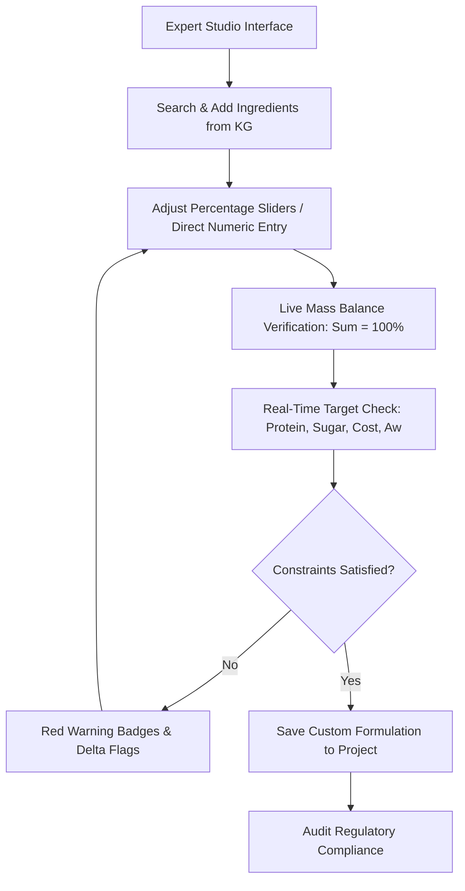

# Workflow Documentation — Food Formulation AI Platform

This document details all end-to-end workflows identified during the complete inspection of the Food Formulation AI Platform. Each workflow specifies its starting page, required inputs, step-by-step UI sequence, backend operations, algorithmic calculations, generated outputs, final destinations, and implementation status.

---

## 1. Primary Workflow: 5-Stage Guided Formulation Pipeline

The flagship workflow of the platform guides food scientists from an unstructured natural language brief through automated entity extraction, constraint prioritization, Pareto candidate generation, numerical optimization, and multi-dimensional reporting.

### Workflow Metadata
- **Starting Route:** `/dashboard/formulate/guided` (Stage 1: Product Brief)
- **Primary Actors:** Food Formulator, R&D Product Developer, Regulatory Specialist
- **Implementation Status:** **Fully Implemented** (End-to-End Grounded)

```mermaid
sequenceDiagram
    autonumber
    actor User as Food Scientist
    participant UI as Next.js Frontend
    participant API as FastAPI Backend
    participant KG as SQLite / Neo4j KG
    participant Opt as SLSQP Optimizer (SciPy)

    User->>UI: Submit Brief / Select Preset ("High-Protein Snack Bar")
    UI->>API: POST /api/pipeline/extract-constraints
    API-->>UI: Extracted Target Attributes & Constraints
    User->>UI: Review & Modify Extracted Constraints (Stage 2)
    User->>UI: Classify Hard vs. Soft Goals & Set Weights (Stage 3)
    UI->>API: POST /api/pipeline/generate-candidates
    API->>KG: Graph Traversal & Semantic Filter (23,893 ingredients)
    API->>Opt: SLSQP Mass Balance & Target Optimization
    Opt-->>API: 3 Pareto Candidate Sets (Cost, Balanced, Premium)
    API-->>UI: Candidate Sets with Ranks & Pareto Metrics
    User->>UI: Inspect Candidate Set Modal & Compare Ingredients (Stage 4)
    User->>UI: Click "Select This Candidate Set & View Final Report"
    UI->>API: POST /api/pipeline/finalize-formulation
    API-->>UI: Full 7-Tab Analytical Dossier (Stage 5)
```

---

### Step-by-Step Execution Sequence

#### Stage 1: Product Brief Submission
- **Screen:** `/dashboard/formulate/guided` (Step 1)
- **Inputs:**
  - Product Category (e.g., `Snack Bar / Confectionery`, `Ready-to-Drink Beverage`, `Plant-Based Dairy Alternative`)
  - Target Market / Geography (`North America (FDA)`, `European Union (EFSA)`, `India (FSSAI)`)
  - Batch Size Target (`100g serving base` / `1000kg production run`)
  - Natural Language Brief (or one-click presets like "Gluten-Free High Protein Snack Bar with Almond Butter & Low Sugar")
- **Action:** Formulator clicks **"Extract Constraints & Analyze Brief"**.
- **Backend Operation:** `POST /api/pipeline/extract-constraints` executes NLP entity extraction, resolving nutritional targets, functional attributes, and allergen exclusions.
- **Output:** Extracted specification object loaded into client state.

#### Stage 2: Constraint Discovery & Entity Extraction
- **Screen:** `/dashboard/formulate/guided` (Step 2)
- **Inputs:** User reviews extracted constraints organized into:
  - Nutritional thresholds (`Protein ≥ 35g`, `Sugar ≤ 5g`, `Sodium ≤ 200mg`, `Calories ≤ 250 kcal`)
  - Physicochemical parameters (`Water Activity Aw ≤ 0.65`, `Moisture ≤ 12%`, `pH 5.5 - 6.5`)
  - Regulatory standards (`FDA 21 CFR Compliant`, `Clean Additive`, `GRAS Verified`)
  - Allergen Exclusions (`Tree Nuts`, `Peanuts`, `Dairy`, `Gluten`, `Soy`)
- **Action:** Formulator toggles, modifies thresholds, or removes infeasible allergens.
- **Backend Operation:** Local state synchronization; triggers validation check against ingredient availability.
- **Output:** Confirmed target specification schema.

#### Stage 3: Hard vs. Soft Goals Prioritization
- **Screen:** `/dashboard/formulate/guided` (Step 3)
- **Inputs:**
  - Hard Constraints (Mandatory binary pass/fail boundary conditions: e.g., Gluten-Free certification, non-negotiable allergen exclusion, legal maximum sodium).
  - Soft Goals (Multi-objective optimization sliders: Cost minimization, Protein maximization, Texture score, Shelf-life stability).
- **Action:** Formulator balances priority sliders and clicks **"Generate Candidate Formulations"**.
- **Backend Operation:** `POST /api/pipeline/generate-candidates`.
  - Queries `tcs_food_formulator_kg.db` across 23,893 ingredients.
  - Applies binary pruning (removes excluded allergens and non-compliant GRAS substances).
  - Feeds candidate matrices to SciPy `minimize(method='SLSQP')` subjected to $\sum w_i = 100\%$, $l_i \le w_i \le u_i$, and nutritional matrix constraints $A_{nutr} \cdot w \ge b$.
- **Output:** Generated Pareto-optimal candidate sets with composite rankings.

#### Stage 4: Candidate Set Evaluation & Inspection
- **Screen:** `/dashboard/formulate/guided` (Step 4)
- **Inputs:** Interactive inspection of 3 candidate strategy cards:
  - `Rank #1: Cost-Optimized Strategy` (Focus on cost/kg minimization)
  - `Rank #2: Balanced Performance Strategy` (Balanced sensory, stability, and cost)
  - `Rank #3: Premium Nutrition Strategy` (Maximized functional isolates and organics)
- **Features & Actions:**
  - Click **"Inspect Candidate Set"** to open a detailed modal displaying the full ingredient table, percentages, functional roles, regulatory status, and cost breakdown.
  - View real-time radar chart of multi-dimensional performance.
  - Click **"Select This Candidate Set & View Final Report"**.
- **Output:** Selected candidate set bound to global formulation state.

#### Stage 5: Final Formulation Dossier & Analytical Verification
- **Screen:** `/dashboard/formulate/guided` (Step 5)
- **Layout & Structure:** Seven specialized analytical sub-tabs:
  1. **Overview:** Executive summary, overall compliance score (e.g., 94.2%), mass balance verification, and macro donut chart.
  2. **Ingredients:** Exhaustive formulation table with ingredient names, botanical source, precise mass percentage ($w/w\%$), batch grams ($g$), functional role, regulatory grade, and ingredient unit cost.
  3. **Process:** Recommended mixing order, thermal treatment parameters, shear rate, critical control points (HACCP), and packaging atmosphere recommendations.
  4. **Cost Analysis:** Direct ingredient-level cost breakdown per batch and per kg, comparative target variance, and bulk pricing estimations.
  5. **Nutrition Profile:** Dynamic macronutrient radar and target progress bars (Protein, Carbohydrates, Calories, Key Minerals, Fat, Aw).
  6. **Allergens & Compliance:** FDA/EFSA/FSSAI regulatory validation, declared allergens pill badges, cross-contact risk matrix, and clean label verification badges.
  7. **AI Rationale:** Traceable formulation rationale explaining why specific ingredient substitutions and percentages were converged upon.
- **Export Action:** One-click print/PDF generation button (`Export Technical Dossier`).

---

## 2. Secondary Workflow: Expert Studio (Manual Formulation & Real-Time Solver)

The Expert Studio provides food technologists with full manual control over formulation recipes with live constraint validation and mass-balance enforcement.

### Workflow Metadata
- **Starting Route:** `/dashboard/formulate/expert`
- **Primary Actors:** Senior Food Formulation Scientists, Process Engineers
- **Implementation Status:** **Fully Implemented**



### Execution Details:
1. **Ingredient Selection:** Technologist searches the 23,893-ingredient knowledge base via typeahead search.
2. **Batch Composition:** Adding ingredients populates interactive rows with percentage sliders and numerical inputs.
3. **Real-Time Mass Normalization:** The client monitors $\sum w_i$. If the total diverges from 100%, an alert flags over/under mass allocations.
4. **Instant Calculation Engine:** As sliders move, nutritional sums (calories, protein, fats, sodium) and ingredient costs dynamically update in the sidebar.
5. **Persistence:** Formulator clicks "Save Formulation" to persist to SQLite (`formulations` table via `POST /api/formulations`).

---

## 3. Knowledge Graph & Ingredient Explorer Workflow

Allows researchers to explore ingredient relationships, functional taxonomy, processing behaviors, and substitute alternatives.

### Workflow Metadata
- **Starting Route:** `/dashboard/ingredients` & `/dashboard/knowledge-graph`
- **Primary Actors:** R&D Ingredient Specialists, Sourcing Managers
- **Implementation Status:** **Fully Implemented**

### Step-by-Step Sequence:
1. **Catalog Browsing:** User accesses `/dashboard/ingredients` displaying paginated ingredient cards with badges (category, allergen profile, cost/kg, protein content).
2. **Category & Search Filtering:** User filters by functional category (Proteins, Sweeteners, Emulsifiers, Hydrocolloids, Bulking Agents) or types search queries.
3. **Ingredient Inspection Drawer:** Clicking any ingredient row opens a slide-over drawer detailing:
   - Physicochemical constants ($A_w$, pH, solubility, melting point)
   - Heavy metal & microbial thresholds
   - Allergen classifications
   - Regulatory approvals across jurisdictions
4. **Knowledge Graph Exploration:** User navigates to `/dashboard/knowledge-graph` or clicks "View in Graph":
   - Interactive SVG/Canvas node-link visualization showing `Ingredient`, `FunctionalClass`, `Allergen`, and `RegulatoryStatus` nodes.
   - Connected edges illustrate `REPLACES`, `COMPATIBLE_WITH`, and `BELONGS_TO_CLASS` relationships.

---

## 4. Multi-Jurisdictional Regulatory & Compliance Audit Workflow

Validates existing or draft formulations against global food safety standards and allergen labeling laws.

### Workflow Metadata
- **Starting Route:** `/dashboard/compliance`
- **Primary Actors:** Quality Assurance (QA) Managers, Regulatory Affairs Officers
- **Implementation Status:** **Fully Implemented**

### Step-by-Step Sequence:
1. **Accessing Compliance Matrix:** User navigates to `/dashboard/compliance`.
2. **Formulation Selection:** User picks an active formulation from the project dropdown.
3. **Jurisdiction Selection:** Toggles between `FDA (United States)`, `EFSA (European Union)`, and `FSSAI (India)`.
4. **Automated Verification:**
   - Evaluates maximum permissible limits for additives (Codex Alimentarius GSFA).
   - Validates allergen declaration mandates (e.g., US FALCPA 9 major allergens vs. EU 14 allergens).
   - Verifies packaging claim thresholds (e.g., "High Protein": $\ge 20\%$ DV, "Gluten Free": $< 20\text{ ppm}$).
5. **Audit Logging:** System creates an immutable compliance audit record in `compliance_logs`.

---

## 5. Project Management & Formulation Versioning Workflow

Enables food enterprise teams to organize multiple formulations into client projects, track iterations, and compare variant metrics.

### Workflow Metadata
- **Starting Route:** `/dashboard`
- **Primary Actors:** Project Leads, R&D Directors
- **Implementation Status:** **Fully Implemented**

### Step-by-Step Sequence:
1. **Dashboard Overview:** Displays active projects, total formulations created, recent compliance scores, and quick metrics.
2. **Create Project:** Formulator clicks "New Project", inputs project title (e.g., "Clean-Label Plant Protein Beverage"), and assigns target launch date.
3. **Formulation Duplication & Branching:** Formulators can clone existing formulations to iterate on flavor variants (e.g., Vanilla vs. Chocolate base) without disrupting original baselines.
4. **Project Archival & Deletion:** Standard lifecycle management for completed projects.

---

## 6. Authentication & User Session Workflow

Secures proprietary formulation intellectual property and ensures regulatory audit traceability.

### Workflow Metadata
- **Starting Routes:** `/login`, `/register`, `/signup`
- **Primary Actors:** All system users
- **Implementation Status:** **Fully Implemented**

### Step-by-Step Sequence:
1. **New User Registration:** User visits `/register` or `/signup`, inputs Name, Email, Organization, and Password. Backend hashes password via Passlib (bcrypt) and writes to `users` table.
2. **User Login:** User enters credentials at `/login`. Backend validates credentials (`POST /api/auth/login`), generating a JWT bearer token.
3. **Session Persistence:** Next.js client stores token in local storage / secure cookies; Axios interceptor attaches `Authorization: Bearer <token>` to all protected endpoints.
4. **Profile Management:** Accessible via `/dashboard/profile` to update user details, view company affiliation, and sign out.

