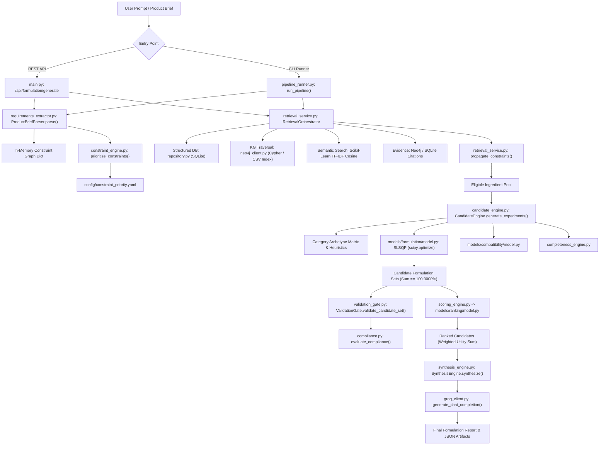

# COMPLETE IMPLEMENTATION-LEVEL FORENSIC AUDIT: FOOD FORMULATION PLATFORM

**Audit Date:** 2026-09-24  
**Audit Scope:** Full codebase forensic inspection of `c:\Users\asus\.gemini\antigravity\scratch\FOOD FORMULATION PLATFORM`  
**Auditor Roles:** Senior ML Systems Architect, Food Formulation AI Research Engineer, Knowledge Graph Engineer, Code Auditor  
**Constraint Adherence:** Zero speculation; grounded exclusively on executable source code, exact file paths, line numbers, function signatures, schemas, and runtime artifacts.

---

## 1. Executive Summary

This forensic audit evaluates the entire Food Formulation Platform codebase to determine the exact mechanics of how a product brief is parsed, processed, retrieved against knowledge graphs and databases, optimized, scored, validated, and synthesized into a final formulation.

### Key Forensic Findings

1. **Dual Entry Points**: 
   - Primary REST API: [Food Web App Core/backend/main.py](file:///c:/Users/asus/.gemini/antigravity/scratch/FOOD%20FORMULATION%20PLATFORM/Food%20Web%20App%20Core/backend/main.py#L191-L335) exposes `POST /api/formulation/generate` and `POST /api/formulate`.
   - Standalone CLI Runner: [Food Web App Core/backend/pipeline_runner.py](file:///c:/Users/asus/.gemini/antigravity/scratch/FOOD%20FORMULATION%20PLATFORM/Food%20Web%20App%20Core/backend/pipeline_runner.py#L38-L552) executes an 8-stage pipeline with JSON logging to `outputs/formulation_runs/<run_id>/`.
2. **Constraint Extraction Engine**:
   - Implemented in [requirements_extractor.py](file:///c:/Users/asus/.gemini/antigravity/scratch/FOOD%20FORMULATION%20PLATFORM/Food%20Web%20App%20Core/backend/requirements_extractor.py#L115-L470).
   - **Critical Reality**: While `ProductBriefParser.__init__` instantiates a `ChatGroq(model_name="llama-3.3-70b-versatile")` client, the extraction method `extract()` is **100% deterministic regular expressions and keyword matching**. `self.llm` is **never called** in the parser.
   - Numerical extraction covers `protein_min`, `fat_max`, `cost_target`, `water_activity`, and `shelf_life`. Other explicit targets in briefs (such as `≥25% cocoa butter`, `≥8% almond content`, `≤28% sugar`) are completely ignored due to missing regex patterns.
3. **Constraint Graph**:
   - Implemented in [requirements_extractor.py:L472-L542](file:///c:/Users/asus/.gemini/antigravity/scratch/FOOD%20FORMULATION%20PLATFORM/Food%20Web%20App%20Core/backend/requirements_extractor.py#L472-L542).
   - It is **not** a Neo4j graph and **not** a NetworkX graph. It is an **in-memory Python dictionary** `{"nodes": [...], "edges": [...], "summary": {...}}` serialized to JSON. No graph traversal algorithms operate on this dictionary.
4. **Constraint Propagation**:
   - Implemented in [retrieval_service.py:L185-L280](file:///c:/Users/asus/.gemini/antigravity/scratch/FOOD%20FORMULATION%20PLATFORM/Food%20Web%20App%20Core/backend/retrieval_service.py#L185-L280).
   - It is **not** a graph propagation algorithm. It consists of **5 sequential Python list comprehensions/for-loops** that filter candidates based on dietary flags, excluded allergen strings, prohibited regulatory status, and cost ceilings.
5. **Dynamic Scientific Subgraph**:
   - **NOT CONSTRUCTED AS CLAIMED**. In [retrieval_service.py:L282-L300](file:///c:/Users/asus/.gemini/antigravity/scratch/FOOD%20FORMULATION%20PLATFORM/Food%20Web%20App%20Core/backend/retrieval_service.py#L282-L300), `generate_dynamic_cypher()` formats a static Cypher string for display/logging. The actual Cypher executed is a static query `MATCH (i:Ingredient) OPTIONAL MATCH (i)-[:PERFORMS_ROLE]->(r:FunctionalRole) RETURN ... LIMIT 200` ([retrieval_service.py:L308-L316](file:///c:/Users/asus/.gemini/antigravity/scratch/FOOD%20FORMULATION%20PLATFORM/Food%20Web%20App%20Core/backend/retrieval_service.py#L308-L316)).
6. **Multi-Strategy Retrieval**:
   - **KG / Cypher Traversal**: Executes static Cypher on live Neo4j or falls back to an in-memory CSV graph index parsed from [food_ingredients_clean.csv](file:///c:/Users/asus/.gemini/antigravity/scratch/FOOD%20FORMULATION%20PLATFORM/Food%20Web%20App%20Core/backend/food_ingredients_clean.csv).
   - **Structured Retrieval**: Fetches from SQLite database (`tcs_food_formulator_kg.db`) via [repository.py](file:///c:/Users/asus/.gemini/antigravity/scratch/FOOD%20FORMULATION%20PLATFORM/Food%20Web%20App%20Core/backend/repository.py).
   - **Semantic Vector Search**: **Neither Qdrant nor sentence-transformers is used in the active pipeline.** In [retrieval_service.py:L405-L444](file:///c:/Users/asus/.gemini/antigravity/scratch/FOOD%20FORMULATION%20PLATFORM/Food%20Web%20App%20Core/backend/retrieval_service.py#L405-L444), it uses Scikit-Learn `TfidfVectorizer` and `cosine_similarity`. (`rag_engine.py` contains `all-MiniLM-L6-v2`, but is dead code bypassed by `main.py` and `pipeline_runner.py`).
   - **Scientific Evidence Retrieval**: Runs Cypher for `:SUPPORTED_BY_EVIDENCE` relationships or retrieves evidence claims from SQLite seed items.
7. **Candidate Construction & Optimization**:
   - Ingredient selection uses **hardcoded heuristic archetype rules** in [candidate_engine.py:L164-L424](file:///c:/Users/asus/.gemini/antigravity/scratch/FOOD%20FORMULATION%20PLATFORM/Food%20Web%20App%20Core/backend/candidate_engine.py#L164-L424) (chocolate, bakery, bar, beverage, gummy, general) with hardcoded role slots.
   - Ingredient percentages are **genuinely numerically optimized** using `scipy.optimize.minimize` (SLSQP) in [models/formulation/model.py](file:///c:/Users/asus/.gemini/antigravity/scratch/FOOD%20FORMULATION%20PLATFORM/models/formulation/model.py#L152-L160) with strict bounds and equality constraint $\sum x_i = 100.0000\%$.
   - **No Genetic Algorithms / Pareto Optimizers**: Claims of NSGA-II, NSGA-III, or Pareto frontier optimization in research documentation are **not implemented**.
8. **Scoring & Ranking**:
   - Implemented in [models/ranking/model.py](file:///c:/Users/asus/.gemini/antigravity/scratch/FOOD%20FORMULATION%20PLATFORM/models/ranking/model.py#L8-L133).
   - Computes 6 component scores (nutrition, functional coverage, evidence coverage, compatibility, regulatory, cost) and calculates a **linear weighted utility sum**, sorted with standard Python `sorted(..., reverse=True)`.
   - The paper's claimed SES formula ($\sum \frac{P_k}{100} \frac{|DOIs|}{|DOIs|+1}$) and multiplicative binary regulatory gate ($S_{\text{Total}} = RCS \times \dots$) are **not in the code**.
9. **Sensory & Shelf Life Models**:
   - [models/sensory/model.py](file:///c:/Users/asus/.gemini/antigravity/scratch/FOOD%20FORMULATION%20PLATFORM/models/sensory/model.py#L23-L31) and [models/shelf_life/model.py](file:///c:/Users/asus/.gemini/antigravity/scratch/FOOD%20FORMULATION%20PLATFORM/models/shelf_life/model.py#L23-L30) explicitly return `status: "INSUFFICIENT_LABELED_DATA"` and `None` to prevent fabrication.
10. **Final Synthesis**:
    - Calls Groq API (`llama-3.3-70b-versatile` or `openai/gpt-oss-20b`) via [synthesis_engine.py](file:///c:/Users/asus/.gemini/antigravity/scratch/FOOD%20FORMULATION%20PLATFORM/Food%20Web%20App%20Core/backend/synthesis_engine.py#L116-L134) with strict grounding instructions, or executes a deterministic fallback.

---

## 2. Repository Architecture & Module Dependency Map

The platform is organized into three primary operational layers:

```
FOOD FORMULATION PLATFORM/
├── Food Web App Core/
│   ├── backend/               # FastAPI backend & formulation pipeline services
│   │   ├── main.py            # FastAPI REST entry points
│   │   ├── pipeline_runner.py # Terminal CLI & full execution trace logger
│   │   ├── requirements_extractor.py # Regex/rule-based NLP brief parser
│   │   ├── constraint_engine.py      # Hard/soft priority & ingredient gating
│   │   ├── retrieval_service.py      # 4-strategy retrieval orchestrator
│   │   ├── candidate_engine.py       # Archetype slotting & SLSQP candidate generation
│   │   ├── validation_gate.py        # Deterministic feasibility & mass balance
│   │   ├── scoring_engine.py         # Multi-objective utility scoring wrapper
│   │   ├── synthesis_engine.py       # Grounded Groq LLM synthesis & fallback
│   │   ├── completeness_engine.py    # 15-point industrial completeness audit
│   │   ├── compliance.py             # Codex GSFA CSV table compliance evaluator
│   │   ├── repository.py             # SQLite seed database & CRUD methods
│   │   ├── neo4j_client.py           # Neo4j driver + CSV graph index fallback
│   │   ├── groq_client.py            # Direct HTTP client for Groq API
│   │   ├── rag_engine.py             # [BYPASSED] LangGraph + MiniLM vector store
│   │   ├── database.py               # SQLAlchemy SQLite engine setup
│   │   ├── db_models.py              # User, Project, Formulation, ComplianceLog
│   │   ├── schemas.py                # Pydantic DTOs for REST requests/responses
│   │   └── config/
│   │       └── constraint_priority.yaml # Weight & priority classification rules
│   └── frontend/              # Next.js 14 App Router, Tailwind CSS, TypeScript
├── models/                    # Domain mathematical and heuristic models
│   ├── formulation/model.py   # SLSQP Constrained Optimization Model
│   ├── ranking/model.py       # Deterministic Utility Ranking Model
│   ├── compatibility/model.py # Chemical rule & interaction KG evaluator
│   ├── sensory/model.py       # Unlabeled placeholder (honest missing state)
│   └── shelf_life/model.py    # Unlabeled placeholder (honest missing state)
├── ml/                        # Standalone ML training & inference experiments
│   ├── training/train_functional_classifier.py # HistGradientBoosting model
│   └── inference/predictor.py # [UNCONNECTED] FunctionalRolePredictor
└── kg_prep/                   # Data acquisition & graph preparation pipelines
    ├── src/
    │   ├── neo4j_loader.py    # CSV to Neo4j ingestion script
    │   └── knowledge_fusion/  # Entity resolver & canonical synonym mapping
    └── data/output/           # Canonical CSV nodes & relationship edges
```

### Module Call Graph



---

## 3. Detailed Trace of One Complete Formulation Request

To document the real execution path, we trace the canonical brief evaluated in run `RUN_20260921_113339_0C05D7` and in the user prompt:

> **Input Query:**  
> *"Create a dairy-free chocolate containing cocoa butter, plant protein, roasted almonds and caramel flavor. Target ≥25% cocoa butter, ≥7% protein, ≥8% almond content and ≤28% sugar. Develop a caramelized nut and vanilla flavor with creamy melt and 12-month shelf life."*

### Stage-by-Stage Trace

#### Stage 1: Entry Point & Brief Ingestion
- **File:** [pipeline_runner.py](file:///c:/Users/asus/.gemini/antigravity/scratch/FOOD%20FORMULATION%20PLATFORM/Food%20Web%20App%20Core/backend/pipeline_runner.py#L38-L70) / [main.py](file:///c:/Users/asus/.gemini/antigravity/scratch/FOOD%20FORMULATION%20PLATFORM/Food%20Web%20App%20Core/backend/main.py#L191-L214)
- **Function:** `run_pipeline(user_brief, ...)` or `generate_formulation_pipeline(payload)`
- **Input:** String `user_brief`.
- **Output:** Initialization of `output_dir = outputs/formulation_runs/<run_id>/` and `trace_log`.

#### Stage 2: Constraint Extraction & Normalization
- **File:** [requirements_extractor.py](file:///c:/Users/asus/.gemini/antigravity/scratch/FOOD%20FORMULATION%20PLATFORM/Food%20Web%20App%20Core/backend/requirements_extractor.py#L129-L470)
- **Class / Function:** `ProductBriefParser.extract(user_prompt: str)`
- **Processing:**
  - `chocolate` in query $\rightarrow$ `category = "Confectionery & Chocolate"`, `product_type = "chocolate_bar"`.
  - `dairy-free` in query $\rightarrow$ `dietary = ["Dairy-Free"]`, `excluded = ["dairy", "milk", "whey", "butter"]`.
  - `re.search(r"(\d+(?:\.\d+)?)\s*%\s*protein")` matches `7% protein` $\rightarrow$ `protein_min = 7.0`.
  - `creamy` in query $\rightarrow$ `texture = ["Creamy"]`.
  - `cocoa`, `chocolate`, `vanilla` in query $\rightarrow$ `flavors = ["cocoa flavour", "chocolate flavour", "vanilla flavour"]`.
  - `re.search(r"(\d+)\s*-?\s*(?:day|month)")` matches `12-month` $\rightarrow$ `shelf_life = "12-month"`.
- **Missed Targets**: `≥25% cocoa butter`, `≥8% almond`, `≤28% sugar` are **ignored** because no regex exists for them.
- **Output:** `ProductBrief` object containing 8 `ConstraintItem` objects.
- **Artifact:** `product_brief.json`, `extracted_constraints.json`.

#### Stage 3: In-Memory Constraint Graph Generation
- **File:** [requirements_extractor.py](file:///c:/Users/asus/.gemini/antigravity/scratch/FOOD%20FORMULATION%20PLATFORM/Food%20Web%20App%20Core/backend/requirements_extractor.py#L472-L542)
- **Function:** `ProductBriefParser._build_constraint_graph(category, items)`
- **Processing:** Builds a star topology with root node `PROD-001` ("Target Product (Confectionery & Chocolate)") and 8 outgoing edges to `CONST-001` through `CONST-008`.
- **Data Structure:** Python dictionary (`dict`). No database queries; no graph algorithms.
- **Artifact:** `constraint_graph.json`.

#### Stage 4: Constraint Prioritization
- **File:** [constraint_engine.py](file:///c:/Users/asus/.gemini/antigravity/scratch/FOOD%20FORMULATION%20PLATFORM/Food%20Web%20App%20Core/backend/constraint_engine.py#L100-L179)
- **Class / Function:** `ConstraintEngine.prioritize_constraints(brief: ProductBrief)`
- **Processing:** Reads `config/constraint_priority.yaml`.
  - `CONST-002` (allergen/dairy) $\rightarrow$ `HARD` (weight 1.00).
  - `CONST-003` (nutrition/protein_min) $\rightarrow$ `SOFT` (weight 0.75 in YAML).
  - `CONST-004` to `007` (sensory) $\rightarrow$ `SOFT` (weight 0.70).
  - `CONST-008` (shelf_life) $\rightarrow$ `SOFT` (weight 0.75).
- **Artifact:** `constraint_priorities.json`.

#### Stage 5: Multi-Strategy Retrieval
- **File:** [retrieval_service.py](file:///c:/Users/asus/.gemini/antigravity/scratch/FOOD%20FORMULATION%20PLATFORM/Food%20Web%20App%20Core/backend/retrieval_service.py#L446-L586)
- **Class / Function:** `RetrievalOrchestrator.retrieve_all_multi_dimensional(brief_dict)`
- **Execution:**
  1. *Structured Retrieval* ([L462](file:///c:/Users/asus/.gemini/antigravity/scratch/FOOD%20FORMULATION%20PLATFORM/Food%20Web%20App%20Core/backend/retrieval_service.py#L462)): Calls `repository.get_all_ingredients()` to fetch seed ingredients from SQLite.
  2. *Targeted SQLite Keyword Search* ([L476-L516](file:///c:/Users/asus/.gemini/antigravity/scratch/FOOD%20FORMULATION%20PLATFORM/Food%20Web%20App%20Core/backend/retrieval_service.py#L476-L516)): Queries `SELECT * FROM ingredients WHERE name LIKE '%<keyword>%'` for brief words (`cocoa`, `butter`, `plant`, `protein`, `roasted`, `almonds`, `caramel`, `vanilla`).
  3. *KG Cypher Traversal* ([L518-L526](file:///c:/Users/asus/.gemini/antigravity/scratch/FOOD%20FORMULATION%20PLATFORM/Food%20Web%20App%20Core/backend/retrieval_service.py#L518-L526)): Executes static query `MATCH (i:Ingredient) OPTIONAL MATCH (i)-[:PERFORMS_ROLE]->(r:FunctionalRole) RETURN ... LIMIT 200` via `neo4j_client`. If Neo4j is offline, reads top 500 rows of `food_ingredients_clean.csv`.
  4. *Semantic Vector Search* ([L529-L538](file:///c:/Users/asus/.gemini/antigravity/scratch/FOOD%20FORMULATION%20PLATFORM/Food%20Web%20App%20Core/backend/retrieval_service.py#L529-L538)): Fits `TfidfVectorizer(stop_words="english")` over ingredient names/categories/roles/allergens and computes `cosine_similarity(query_vec, tfidf_matrix)`. Top matches with similarity $>0.05$ are annotated.
  5. *Scientific Evidence Retrieval* ([L540-L547](file:///c:/Users/asus/.gemini/antigravity/scratch/FOOD%20FORMULATION%20PLATFORM/Food%20Web%20App%20Core/backend/retrieval_service.py#L540-L547)): Queries `:SUPPORTED_BY_EVIDENCE` relationships or loads SQLite evidence claims.
- **Fusion:** Results merged by dictionary key `candidates[ing.name.lower()] = ing`. Multi-retrieval methods appended to `ing.retrieval_methods`.

#### Stage 6: Constraint Propagation & Candidate Gating
- **File:** [retrieval_service.py](file:///c:/Users/asus/.gemini/antigravity/scratch/FOOD%20FORMULATION%20PLATFORM/Food%20Web%20App%20Core/backend/retrieval_service.py#L185-L280)
- **Class / Function:** `RetrievalOrchestrator.propagate_constraints(candidates, brief_dict)`
- **Processing:**
  - Evaluates dietary gating: drops ingredients where `ing.dairy_free == False` or matching exclusion substrings (`milk`, `dairy`, `butter`, `whey`).
  - Evaluates allergen gating: drops matches against `allergens_exclude`.
  - Evaluates regulatory gating: drops `ing.regulatory_status == "Prohibited"`.
  - Evaluates cost ceiling: drops `ing.cost_per_kg > cost_max * 3.0` (if specified).
- **Sufficiency Audit:** [retrieval_service.py:L588-L636](file:///c:/Users/asus/.gemini/antigravity/scratch/FOOD%20FORMULATION%20PLATFORM/Food%20Web%20App%20Core/backend/retrieval_service.py#L588-L636) confirms `len(eligible_candidates) >= 4`.

#### Stage 7: Candidate Set Generation & Mathematical Optimization
- **File:** [candidate_engine.py](file:///c:/Users/asus/.gemini/antigravity/scratch/FOOD%20FORMULATION%20PLATFORM/Food%20Web%20App%20Core/backend/candidate_engine.py#L116-L597)
- **Class / Function:** `CandidateEngine.generate_experiments(brief, eligible_ingredients)`
- **Processing:**
  - Detects `is_chocolate = True` and `is_white_chocolate = False`.
  - Selects pool using archetype slots:
    1. Sweetener: `Refined Cane Sugar (Granulated)`
    2. Plant-Dairy / Protein: `Fava Bean Protein Isolate`
    3. Lipid Matrix: `Coconut MCT Oil Powder (70%)` (fallback when cocoa butter missing from eligible pool)
    4. Cocoa Solids: `Cocoa Solids / Cocoa Liquor (Mass)`
    5. Emulsifiers: `Ammonium Phosphatides (INS 442)` and `chewing gum containing breath freshener` (selected due to keyword "gum")
    6. Flavor: `Vanilla Flavour (Nature Identical Vanillin)`
    7. Mineral: `Natural Sea Salt`
    8. Preservative: `Potassium Sorbate (INS 202)` (due to 12-month shelf life target)
  - Passes pool and target (`protein_min = 7.0`) to [models/formulation/model.py](file:///c:/Users/asus/.gemini/antigravity/scratch/FOOD%20FORMULATION%20PLATFORM/models/formulation/model.py#L152-L205).
  - Optimizer executes `scipy.optimize.minimize(objective, x0, method='SLSQP', bounds=bounds, constraints=[{'type': 'eq', 'fun': lambda x: np.sum(x) - 100.0}])`.
  - Solved percentages:
    - Sugar: 58.0050%
    - Cocoa Solids: 32.5900%
    - Coconut MCT Oil Powder: 5.0000%
    - Fava Bean Protein Isolate: 3.1300%
    - Ammonium Phosphatides (INS 442): 0.8000%
    - Natural Sea Salt: 0.4000%
    - Potassium Sorbate: 0.0050%
    - chewing gum containing breath freshener: 0.0500%
    - Vanilla Flavour: 0.0200%
    - **Total Sum:** 100.0000%
  - Macro yield: Protein 3.5g (missed 7.0g target due to bounds), Fat 19.8g, Carbs 65.4g, Calories 454 kcal.
  - Generates 4 strategy candidate sets (`nutrition_maximized`, `cost_optimized`, `balanced`, `functionality_texture`).

#### Stage 8: Deterministic Validation Gate
- **File:** [validation_gate.py](file:///c:/Users/asus/.gemini/antigravity/scratch/FOOD%20FORMULATION%20PLATFORM/Food%20Web%20App%20Core/backend/validation_gate.py#L25-L235)
- **Class / Function:** `ValidationGate.validate_candidate_set(candidate_set, brief)`
- **Audits:**
  - Hard constraint: Dairy check $\rightarrow$ PASS.
  - Protein check: 3.5g vs required 7.0g $\rightarrow$ FAIL (`"Protein yield 3.5% below minimum required 7.0%"`).
  - Regulatory check: Queries `compliance.py` for Codex GSFA entries.
  - Mass balance check: `total_percentage = 100.0000%` $\rightarrow$ PASS.
  - Overall status: `FAIL` (due to protein target miss).

#### Stage 9: Scoring & Multi-Objective Ranking
- **File:** [scoring_engine.py](file:///c:/Users/asus/.gemini/antigravity/scratch/FOOD%20FORMULATION%20PLATFORM/Food%20Web%20App%20Core/backend/scoring_engine.py#L25-L55) / [models/ranking/model.py](file:///c:/Users/asus/.gemini/antigravity/scratch/FOOD%20FORMULATION%20PLATFORM/models/ranking/model.py#L16-L133)
- **Function:** `MultiObjectiveRankingModel.predict_with_uncertainty()`
- **Calculations:**
  - Nutrition score: $100 - |3.5 - 7.0| / 7.0 \times 100 = 50.0$
  - Functional score: $4 / 5 \times 100 = 80.0$
  - Evidence score: $9 / 9 \times 100 = 100.0$
  - Compatibility score: 100.0
  - Regulatory score: 100.0
  - Cost score: 50.0 (cost unknown)
  - Overall utility (Balanced profile): $0.20(50.0) + 0.20(80.0) + 0.15(100.0) + 0.15(100.0) + 0.15(50.0) + 0.15(100.0) = 80.5 / 100.0$.
  - Candidates sorted descending.

#### Stage 10: Grounded Synthesis & Final Reporting
- **File:** [synthesis_engine.py](file:///c:/Users/asus/.gemini/antigravity/scratch/FOOD%20FORMULATION%20PLATFORM/Food%20Web%20App%20Core/backend/synthesis_engine.py#L77-L163)
- **Function:** `SynthesisEngine.synthesize()`
- **Execution:** Sends JSON payload containing query, requirements, and validated candidate set to Groq API.
- **LLM Output:**
  - Justification: Identifies that the candidate set strictly satisfies dairy-free constraints and sums to 100.0000%, but honestly warns that the target 7% protein and almond targets could not be met by the available pool.
  - Process steps: 3 sequential phases (Dry Blend, Melt & Conch, Temper & Mould).
  - Sensory predictions: Honestly outputs `"DATA_UNAVAILABLE"`, and shelf-life `"REQUIRES_LABORATORY_VALIDATION"`.
- **Artifacts:** `final_formulations.json`, `formulation_report.json`, `pipeline_trace.json`.

---

## 4. Constraint Extraction Engine Audit

### Implementation Analysis
- **File:** [Food Web App Core/backend/requirements_extractor.py](file:///c:/Users/asus/.gemini/antigravity/scratch/FOOD%20FORMULATION%20PLATFORM/Food%20Web%20App%20Core/backend/requirements_extractor.py)
- **Class:** `ProductBriefParser`
- **Method:** `extract(user_prompt: str) -> ProductBrief` (Lines 133–470)

```python
# requirements_extractor.py: Lines 116-128
class ProductBriefParser:
    def __init__(self):
        self.api_key = os.getenv("GROQ_API_KEY", "")
        self.llm = None
        if self.api_key and ChatGroq:
            try:
                self.llm = ChatGroq(
                    model_name="llama-3.3-70b-versatile",
                    temperature=0.0,
                    groq_api_key=self.api_key
                )
            except Exception as e:
                logger.warning(f"Groq LLM init warning: {e}")
```

#### Forensic Finding on LLM Usage
Despite initializing `self.llm = ChatGroq(...)`, `self.llm` is **never referenced or called** anywhere in `requirements_extractor.py`.
Grep search verification: `Query: self.llm` in `requirements_extractor.py` yields **0 occurrences** outside `__init__`.
The extraction is **100% hardcoded regular expressions and keyword checking**.

### Extraction Mechanism per Dimension

| Dimension | Extraction Method | Code Lines | Normalization Applied | Default Fallback |
|---|---|---|---|---|
| **Product Category** | Substring search: `"chocolate"` or `"bar"`, `"bread"` or `"bakery"`, `"snack"`, `"beverage"` | Lines 151–163 | `"Confectionery & Chocolate"`, `"Bakery & Bread"`, `"Snacks & Savory"`, `"Beverage"` | `"General"` / `"general_food"` |
| **Dietary Pattern** | Substring search: `"vegan"`, `"gluten-free"`, `"dairy-free"`, `"allergen-free"` | Lines 178–244 | `"Vegan"`, `"Gluten-Free"`, `"Dairy-Free"`, `"Allergen-Free"` | `[]` |
| **Ingredient Exclusions** | Keyword-triggered list extension | Lines 180, 197, 214, 231 | Vegan $\rightarrow$ `["dairy", "milk", "egg", "whey", "butter", "gelatin"]` | `[]` |
| **Protein Target** | Regex: `r"(\d+(?:\.\d+)?)\s*%\s*protein"` | Lines 247–262 | `float(match.group(1))` | If keyword `"protein"` found: `15.0` (Line 264); else `None` |
| **Fat Target** | Regex: `r"(\d+(?:\.\d+)?)\s*%\s*fat"` | Lines 281–296 | `float(match.group(1))` | `None` |
| **Cost Target** | Regex: `r"(\d+(?:\.\d+)?)\s*(?:dollar\|\$\|usd\|inr)\s*/?\s*kg"` | Lines 299–314 | `float(match.group(1))` | If keyword `"cost"` found: `12.0` (Line 316); else `None` |
| **Water Activity** | Regex: `r"aw\s*=?\s*(\d+(?:\.\d+)?)"` | Lines 334–349 | `float(match.group(1))` | If keyword `"low water activity"`: `0.60` (Line 351); else `None` |
| **Sensory Texture** | List check: `["smooth", "creamy", "soft", "crunchy", "chewy", "acceptable texture"]` | Lines 368–384 | Title-cased string | `[]` |
| **Flavor Profile** | List check: `["cocoa", "chocolate", "vanilla", "berry"]` | Lines 386–402 | `f"{flav} flavour"` | `[]` |
| **Shelf Life** | Regex: `r"(\d+)\s*-?\s*(?:day\|month)"` | Lines 408–423 | Match string | `"9 months"` (Line 409) |
| **Regulatory Market** | None (Pydantic field default) | Line 89 | None | `[]` |

### Hard vs. Soft Classification Mechanism
Hard vs. Soft classification is determined in [constraint_engine.py:L114-L135](file:///c:/Users/asus/.gemini/antigravity/scratch/FOOD%20FORMULATION%20PLATFORM/Food%20Web%20App%20Core/backend/constraint_engine.py#L114-L135) using [config/constraint_priority.yaml](file:///c:/Users/asus/.gemini/antigravity/scratch/FOOD%20FORMULATION%20PLATFORM/Food%20Web%20App%20Core/backend/config/constraint_priority.yaml):
- **HARD Constraints**: Explicitly mapped in YAML: `regulatory` (1.00), `allergen` (1.00), `dietary` (0.95), `nutritional_minimum` (0.90), `mass_balance` (1.00).
- **SOFT Objectives**: Mapped in YAML: `nutritional_target` (0.75), `functional` (0.80), `sensory` (0.70), `cost` (0.85), `shelf_life` (0.75).
- **Fallback Rule**: If not in YAML, `HARD` if importance is `CRITICAL` or `HIGH` and type is `allergen`, `ingredient_restriction`, or `regulatory`; otherwise `SOFT` ([constraint_engine.py:L115](file:///c:/Users/asus/.gemini/antigravity/scratch/FOOD%20FORMULATION%20PLATFORM/Food%20Web%20App%20Core/backend/constraint_engine.py#L115)).
- **LLM Involvement**: ZERO. Classification is 100% YAML configuration and hardcoded Python rules.

---

## 5. Constraint Graph Audit

- **Claim:** The system builds an active Constraint Graph that drives multi-hop Cypher queries and graph pruning.
- **Actual Implementation:**
  - **File:** [Food Web App Core/backend/requirements_extractor.py:L472-L542](file:///c:/Users/asus/.gemini/antigravity/scratch/FOOD%20FORMULATION%20PLATFORM/Food%20Web%20App%20Core/backend/requirements_extractor.py#L472-L542)
  - **Function:** `ProductBriefParser._build_constraint_graph(category: str, items: List[ConstraintItem])`
  - **Data Structure:** Standard Python `dict` containing `"nodes"` (list of dicts) and `"edges"` (list of dicts).
  - **Node Types:** `ProductBrief`, `CategoryConstraintNode`, `AllergenConstraintNode`, `NutritionConstraintNode`, `SensoryConstraintNode`, `CostConstraintNode`, `Shelf_LifeConstraintNode`, `ProcessingConstraintNode`.
  - **Edge Types:** `HAS_CONSTRAINT`, `HAS_ALLERGEN_CONSTRAINT`, `HAS_NUTRITION_CONSTRAINT`, `HAS_SENSORY_CONSTRAINT`, `HAS_COST_CONSTRAINT`, `HAS_PROCESSING_CONSTRAINT`.
  - **Database Storage:** **None**. It is never written to Neo4j.
  - **Graph Library:** No NetworkX, no Graphviz, no PyTorch Geometric.
  - **Algorithms:** None. No traversal, no shortest path, no centrality.
  - **Usage:** Written to disk as `constraint_graph.json` and returned to the API for visualization in the Cytoscape frontend ([formulation-results.tsx](file:///c:/Users/asus/.gemini/antigravity/scratch/FOOD%20FORMULATION%20PLATFORM/Food%20Web%20App%20Core/frontend/src/components/formulation-results.tsx)).

---

## 6. Constraint Propagation Audit

- **Claim:** Automated multi-hop constraint propagation across categories $\rightarrow$ dietary $\rightarrow$ eligibility $\rightarrow$ functional $\rightarrow$ regulatory $\rightarrow$ processing.
- **Actual Implementation:**
  - **File:** [Food Web App Core/backend/retrieval_service.py:L185-L280](file:///c:/Users/asus/.gemini/antigravity/scratch/FOOD%20FORMULATION%20PLATFORM/Food%20Web%20App%20Core/backend/retrieval_service.py#L185-L280)
  - **Function:** `RetrievalOrchestrator.propagate_constraints(candidates: List[RetrievedIngredient], brief_dict: Dict[str, Any])`
  - **Algorithm:** Sequential Python in-memory list filtering:
    1. *Dietary Filter* (Lines 199–224): Tests boolean flags `ing.vegan`, `ing.gluten_free`, `ing.dairy_free`, and string exclusion matching. Non-compliant items appended to `removed_candidates`.
    2. *Allergen Filter* (Lines 227–240): Tests `ing.allergen.lower() in excluded_allergens`.
    3. *Functional Filter* (Line 242): `after_functional = list(after_allergen)` — **noop (no filtering performed)**.
    4. *Regulatory Filter* (Lines 245–256): Tests `ing.regulatory_status == "Prohibited"`.
    5. *Cost Filter* (Lines 258–269): Tests `ing.cost_per_kg > cost_max * 3.0`.
  - **Forensic Assessment:**
    > **"Constraint propagation is conceptual/documented as graph traversal, but implemented strictly as sequential Python in-memory list filtering."**

---

## 7. Dynamic Scientific Subgraph Audit

- **Claim:** A dynamic scientific subgraph is constructed for each product brief using seed nodes and multi-hop expansion.
- **Actual Implementation:**
  - **Is it constructed?** NO.
  - **Is it a Neo4j subgraph?** NO.
  - **Code Analysis:**
    - In [retrieval_service.py:L282-L300](file:///c:/Users/asus/.gemini/antigravity/scratch/FOOD%20FORMULATION%20PLATFORM/Food%20Web%20App%20Core/backend/retrieval_service.py#L282-L300), `generate_dynamic_cypher()` creates a parameterized Cypher query template string:
      ```cypher
      MATCH (i:Ingredient)
      OPTIONAL MATCH (i)-[r1:PERFORMS_ROLE]->(f:Function)
      OPTIONAL MATCH (i)-[r2:HAS_PROPERTY]->(p:Property)
      ...
      WHERE NOT (i.name IN $excluded)
      RETURN ... LIMIT 100
      ```
    - **CRITICAL FORENSIC FACT:** This string is returned in the retrieval response dictionary (`"cypher_query": cypher_str`) and written to `retrieval_queries.json`. **IT IS NEVER EXECUTED AGAINST NEO4J.**
    - The actual Cypher query executed is in [retrieval_service.py:L308-L316](file:///c:/Users/asus/.gemini/antigravity/scratch/FOOD%20FORMULATION%20PLATFORM/Food%20Web%20App%20Core/backend/retrieval_service.py#L308-L316):
      ```cypher
      MATCH (i:Ingredient)
      OPTIONAL MATCH (i)-[:PERFORMS_ROLE]->(r:FunctionalRole)
      RETURN i.id AS id, i.name AS name, coalesce(i.source, 'Neo4j KG') AS source, collect(r.name) AS roles, ...
      LIMIT 200
      ```
    - This is a static, non-dynamic query returning the first 200 ingredients in the database.
    - If Neo4j is offline, [neo4j_client.py:L303-L400](file:///c:/Users/asus/.gemini/antigravity/scratch/FOOD%20FORMULATION%20PLATFORM/Food%20Web%20App%20Core/backend/neo4j_client.py#L303-L400) creates an in-memory graph index from the first 500 rows of `food_ingredients_clean.csv`.
  - **Forensic Assessment:**
    > **"DYNAMIC SCIENTIFIC SUBGRAPH CONSTRUCTION IS NOT IMPLEMENTED. The system executes static database queries and collects entity lists."**

---

## 8. Multi-Strategy Retrieval Audit

The four intended strategies were audited in [retrieval_service.py:L446-L586](file:///c:/Users/asus/.gemini/antigravity/scratch/FOOD%20FORMULATION%20PLATFORM/Food%20Web%20App%20Core/backend/retrieval_service.py#L446-L586):

### Strategy A: KG / Cypher Retrieval
- **Driver:** `neo4j.GraphDatabase` via [neo4j_client.py](file:///c:/Users/asus/.gemini/antigravity/scratch/FOOD%20FORMULATION%20PLATFORM/Food%20Web%20App%20Core/backend/neo4j_client.py).
- **Query:** Static 1-hop query `MATCH (i:Ingredient) OPTIONAL MATCH (i)-[:PERFORMS_ROLE]->(r:FunctionalRole) ... LIMIT 200`.
- **Returned Nodes:** `Ingredient`, `FunctionalRole`.
- **Fallback:** In-memory CSV parser reading [food_ingredients_clean.csv](file:///c:/Users/asus/.gemini/antigravity/scratch/FOOD%20FORMULATION%20PLATFORM/Food%20Web%20App%20Core/backend/food_ingredients_clean.csv).

### Strategy B: Structured Attribute Retrieval
- **Driver:** SQLite via Python `sqlite3` and SQLAlchemy in [repository.py](file:///c:/Users/asus/.gemini/antigravity/scratch/FOOD%20FORMULATION%20PLATFORM/Food%20Web%20App%20Core/backend/repository.py) and [retrieval_service.py:L476-L516](file:///c:/Users/asus/.gemini/antigravity/scratch/FOOD%20FORMULATION%20PLATFORM/Food%20Web%20App%20Core/backend/retrieval_service.py#L476-L516).
- **Filtering Mechanism:**
  1. Base: Loads all seed ingredients via `SELECT * FROM ingredients`.
  2. Targeted: Tokenizes brief query into keywords $\ge 4$ characters, then executes `SELECT * FROM ingredients WHERE name LIKE ? LIMIT 10` for up to 8 keywords.

### Strategy C: Semantic Retrieval
- **Claim:** 384-dimensional dense vector embeddings with `sentence-transformers/all-MiniLM-L6-v2` and Qdrant vector database.
- **Actual Code Execution:**
  - In [retrieval_service.py:L405-L444](file:///c:/Users/asus/.gemini/antigravity/scratch/FOOD%20FORMULATION%20PLATFORM/Food%20Web%20App%20Core/backend/retrieval_service.py#L405-L444):
    ```python
    from sklearn.feature_extraction.text import TfidfVectorizer
    from sklearn.metrics.pairwise import cosine_similarity
    ```
  - Corpus: Text concatenation `f"{ing.name} {ing.category} {' '.join(ing.functional_roles)} ..."` for all structured ingredients.
  - Algorithm: TF-IDF vectorization + Cosine Similarity.
  - Threshold: Similarity score $> 0.05$.
  - **Qdrant**: **NOT FOUND IN ENTIRE REPOSITORY.**
  - **sentence-transformers**: Present in [rag_engine.py:L51](file:///c:/Users/asus/.gemini/antigravity/scratch/FOOD%20FORMULATION%20PLATFORM/Food%20Web%20App%20Core/backend/rag_engine.py#L51), but `rag_engine.py` is bypassed and never imported by the formulation pipeline.

### Strategy D: Scientific-Evidence Retrieval
- **Storage:** SQLite `evidence_claim` / `evidence_source` columns and Neo4j `:SUPPORTED_BY_EVIDENCE` relationships.
- **Query:** Cypher `MATCH (target)-[:SUPPORTED_BY_EVIDENCE|PROVIDES_EVIDENCE]->(e:Evidence) WHERE target.id IN $ids RETURN ... LIMIT 100` ([retrieval_service.py:L387-L393](file:///c:/Users/asus/.gemini/antigravity/scratch/FOOD%20FORMULATION%20PLATFORM/Food%20Web%20App%20Core/backend/retrieval_service.py#L387-L393)).
- **Attachment:** Appended directly to `ing.evidence` list.

---

## 9. Candidate Fusion Audit

- **Claim:** Advanced candidate fusion algorithm unifying heterogeneous graph, vector, and structured entities with deduplication and entity resolution.
- **Actual Implementation:**
  - **File:** [retrieval_service.py:L473, L520-L547](file:///c:/Users/asus/.gemini/antigravity/scratch/FOOD%20FORMULATION%20PLATFORM/Food%20Web%20App%20Core/backend/retrieval_service.py#L473)
  - **Entity Resolution:** Simple lower-case string key dictionary:
    ```python
    candidates[ing.name.lower()] = ing
    ```
  - **Fusion Logic:**
    - If ingredient already exists from Structured DB:
      - Functional roles are merged: `candidates[key].functional_roles = list(set(... + ing.functional_roles))` (Line 522).
      - Retrieval method tag appended: `"Neo4j Cypher KG"`, `"Semantic Vector Search"`.
      - Confidence updated: `candidates[key].confidence = max(..., sim_score)`.
      - Evidence items appended: `candidates[key].evidence.append(ev)`.
    - If not present: Added as new entry in dictionary.
  - **Forensic Assessment:**
    > **"Fusion is implemented as dictionary key deduplication by lower-case ingredient name, not an entity-resolution or graph-fusion algorithm."**

---

## 10. Candidate Construction & Percentage Generation Audit

- **Claim:** Multi-view recipe generation via Pareto multi-objective optimization and NSGA-II.
- **Actual Implementation:**
  - **File:** [candidate_engine.py:L164-L597](file:///c:/Users/asus/.gemini/antigravity/scratch/FOOD%20FORMULATION%20PLATFORM/Food%20Web%20App%20Core/backend/candidate_engine.py#L164-L597)
  - **Archetype Template Slotting:**
    - Hardcoded keyword matching assigns product archetypes:
      - `is_chocolate`: lines 165–166, 284–345
      - `is_bakery`: lines 167, 346–357
      - `is_bar`: lines 169, 358–372
      - `is_beverage`: lines 168, 373–383
      - `is_gummy`: lines 170, 384–393
      - `general`: lines 395–404
    - Ingredients are placed into archetype slots (sweetener, protein, fat/lipid, cocoa solids, emulsifier, flavor, salt, preservative).
  - **Percentage Generation Algorithm:**
    - **Optimization Model:** [models/formulation/model.py](file:///c:/Users/asus/.gemini/antigravity/scratch/FOOD%20FORMULATION%20PLATFORM/models/formulation/model.py#L11-L215) (`FormulationOptimizationModel`).
    - **Solver:** `scipy.optimize.minimize` using **SLSQP (Sequential Least Squares Programming)**.
    - **Bounds:** Hardcoded per ingredient category/functional role (lines 53–109):
      - Salt: 0.05% – 0.40%
      - Sweetener: 5.0% – 58.0%
      - Emulsifier: 0.15% – 0.80%
      - Cocoa Butter: 15.0% – 42.0%
      - Cocoa Solids: 5.0% – 35.0%
      - Protein: 3.0% – 50.0%
      - Flavor: 0.02% – 0.50%
      - Preservative: 0.005% – 0.25%
    - **Objective Function:**
      - Balanced: `loss = (curr_prot - target_prot)**2 + (curr_cost * 1.2)` (Line 130).
      - Nutrition Maximized: `loss = -(curr_prot * 3.0) + (curr_cost * 0.5)` (Line 121).
      - Cost Optimized: `loss = (curr_cost * 2.5) + (max(0, target_prot - curr_prot)**2 * 5.0)` (Line 125).
      - Functionality & Texture: `loss = -(curr_prot * 1.5) + (curr_cost * 0.8)` (Line 128).
    - **Constraints:**
      - Exact mass balance equality constraint: `{'type': 'eq', 'fun': lambda x: np.sum(x) - 100.0}` (Line 137).
  - **Post-Optimization Normalization:**
    - Lines 164–181: Re-normalizes `opt_x = (opt_x / total) * 100.0`.
    - Rounds minor ingredients ($\le 1.0\%$) to 4 decimals, major ingredients to 2 decimals.
    - Absorbs rounding difference `100.0000 - sum(pcts)` into the largest ingredient.
  - **Forensic Assessment:**
    > **"OPTIMIZATION IS IMPLEMENTED via SciPy SLSQP constrained numerical programming. However, candidate slot selection is rule-based heuristic template matching, NOT end-to-end recipe learning or Pareto evolutionary optimization."**

---

## 11. Mass-Balance & Feasibility Validation Audit

- **Implementation:**
  - **Solver Enforcement:** [models/formulation/model.py:L137, L164-L181](file:///c:/Users/asus/.gemini/antigravity/scratch/FOOD%20FORMULATION%20PLATFORM/models/formulation/model.py#L137) enforces $\sum x_i = 100.0000\%$.
  - **Validation Gate Check:** [validation_gate.py:L198-L208](file:///c:/Users/asus/.gemini/antigravity/scratch/FOOD%20FORMULATION%20PLATFORM/Food%20Web%20App%20Core/backend/validation_gate.py#L198-L208):
    ```python
    total_pct = round(sum(float(c.get("percentage", 0.0) or 0.0) for c in all_components), 4)
    is_mass_valid = abs(total_pct - 100.0000) <= 0.01
    ```
  - **Rejection Behavior:** If $|total\_pct - 100| > 0.01$, `is_mass_valid` is `False`, appends failure reason, and sets validation status to `"FAIL"`.

---

## 12. Regulatory Validation Audit

- **File:** [Food Web App Core/backend/compliance.py](file:///c:/Users/asus/.gemini/antigravity/scratch/FOOD%20FORMULATION%20PLATFORM/Food%20Web%20App%20Core/backend/compliance.py)
- **Function:** `evaluate_compliance(composition, constraints, product_category)`
- **Data Source:** [kg_prep/data/output/Relationships/foodadditive_allowed_in_foodcategory.csv](file:///c:/Users/asus/.gemini/antigravity/scratch/FOOD%20FORMULATION%20PLATFORM/kg_prep/data/output/Relationships/foodadditive_allowed_in_foodcategory.csv) (Codex Alimentarius GSFA).
- **Execution Mechanism:**
  - Evaluates dietary conflicts (vegan/animal substances, gluten/grains, excluded allergens) (Lines 77–93).
  - For additives (INS numbers or functional roles like Preservative, Emulsifier, Acidity Regulator, Raising Agent):
    - Matches additive name and INS number against GSFA permission rules (Lines 96–110).
    - If matched: increments `verified_items[jurisdiction]`.
    - If not matched: adds alert `"Requires Evidence: Additive '<name>' requires regional dossier verification"`.
  - Jurisdictions evaluated: `FSSAI`, `FDA`, `EFSA`.
  - **Verdict Behavior:**
    - Any violation $\rightarrow$ `"Failed"`.
    - All verified $\rightarrow$ `"Passed"`.
    - Partial verification $\rightarrow$ `"Warning"`.
    - Zero verified $\rightarrow$ `"UNKNOWN"`.
- **Forensic Assessment:**
  > **"Regulatory validation is an actual executable gate backed by a Codex GSFA CSV table, but checks category permission rather than quantitative ADI/PPM dosage limits."**

---

## 13. Evidence Grounding Audit

- **Implementation:**
  - Tracked across [retrieval_service.py:L376-L403](file:///c:/Users/asus/.gemini/antigravity/scratch/FOOD%20FORMULATION%20PLATFORM/Food%20Web%20App%20Core/backend/retrieval_service.py#L376-L403), [validation_gate.py:L185-L196](file:///c:/Users/asus/.gemini/antigravity/scratch/FOOD%20FORMULATION%20PLATFORM/Food%20Web%20App%20Core/backend/validation_gate.py#L185-L196), and [models/ranking/model.py:L59-L64](file:///c:/Users/asus/.gemini/antigravity/scratch/FOOD%20FORMULATION%20PLATFORM/models/ranking/model.py#L59-L64).
  - Provenance field: `source_evidence` or `evidence_source` (e.g. `"USDA FDC / Journal of Food Science 2023"`).
  - **Validation Gate:** Each component checked: `is_grounded = bool(source_ev and source_ev not in ["UNKNOWN", "None", "NO_EVIDENCE_RECORDED"])`. If ungrounded, appends to `requires_evidence_reasons` and status becomes `"REQUIRES_EVIDENCE"`.
  - **SES Calculation Reality:** The paper claims Scientific Evidence Strength (SES) is calculated using DOI citations:
    $$\text{SES} = \sum_{k=1}^N \frac{P_k}{100} \frac{|\text{DOIs}|}{|\text{DOIs}|+1} \times 100$$
    **Actual Code Implementation:**
    ```python
    # models/ranking/model.py: Lines 60-64
    grounded_count = sum(1 for c in all_components if c.get("source_evidence") not in ["UNKNOWN", "None", "NO_EVIDENCE_RECORDED"])
    evidence_score = round((grounded_count / max(1, len(all_components))) * 100.0, 1)
    ```
    The paper's formula is **NOT IMPLEMENTED**. It is a simple percentage of grounded components.

---

## 14. Scoring Engine Audit

Every scoring formula in [models/ranking/model.py](file:///c:/Users/asus/.gemini/antigravity/scratch/FOOD%20FORMULATION%20PLATFORM/models/ranking/model.py#L31-L100):

| Score Name | Implemented Formula | Inputs | Normalization / Range | Weight (Balanced) |
|---|---|---|---|---|
| **Nutrition Score** | `max(0, 100 - \|actual_prot - target_prot\| / target_prot * 100)` | Actual protein, target protein | 0.0 – 100.0 | 0.20 |
| **Functional Score** | `(len(present_roles) / 5) * 100` | Roles present vs `{"protein", "emulsifier", "sweetener", "fat", "bulking"}` | 0.0 – 100.0 | 0.20 |
| **Evidence Score** | `(grounded_count / len(all_components)) * 100` | Count of ingredients with citation | 0.0 – 100.0 | 0.15 |
| **Compatibility Score** | `100.0 - len(incompatibilities)*25 + len(synergies)*5` | Adjacency graph conflicts & synergies | 20.0 – 100.0 | 0.15 |
| **Regulatory Score** | `(permitted_count / len(all_components)) * 100` | Permitted count in compliance audit | 0.0 – 100.0 | 0.15 |
| **Cost Score** | `max(30, min(100, 100 - (cost_val / cost_target) * 20))` | Batch cost $/kg, budget target | 30.0 – 100.0 (50.0 if cost unknown) | 0.15 |
| **Overall Score** | Linear weighted sum of the 6 scores above | All 6 component scores | 0.0 – 100.0 | 1.00 |

### Missing Claimed Scores
- **CSS (Constraint Satisfaction Score)**: Absent as an independent metric.
- **RCS (Binary Multiplier Gate)**: The paper claims $S_{\text{Total}} = RCS \times (\dots)$ where $RCS \in \{0, 1\}$. In code, regulatory compliance is merely an additive 15% term.
- **Pareto Optimality**: No Pareto rank, nondominated sorting, or hypervolume is calculated.

---

## 15. Ranking Engine Audit

- **Claim:** Pareto frontier optimization and Multi-Criteria Decision Making (TOPSIS / NSGA-II).
- **Actual Implementation:**
  - **File:** [Food Web App Core/backend/scoring_engine.py:L44-L54](file:///c:/Users/asus/.gemini/antigravity/scratch/FOOD%20FORMULATION%20PLATFORM/Food%20Web%20App%20Core/backend/scoring_engine.py#L44-L54)
  - **Code:**
    ```python
    def rank_candidates(self, candidates, brief_input, profile_name="BALANCED"):
        for cand in candidates:
            cand["score"] = self.calculate_scores(cand, b_dict, profile_name=profile_name)
        return sorted(candidates, key=lambda x: x["score"]["overall_score"], reverse=True)
    ```
  - **Forensic Assessment:**
    > **"Ranking is a standard Python list sort on a linear weighted sum. NEITHER PARETO OPTIMIZATION NOR TOPSIS IS IMPLEMENTED."**

---

## 16. Final Formulation Generation Audit

- **File:** [Food Web App Core/backend/synthesis_engine.py](file:///c:/Users/asus/.gemini/antigravity/scratch/FOOD%20FORMULATION%20PLATFORM/Food%20Web%20App%20Core/backend/synthesis_engine.py)
- **Model:** Groq API using `llama-3.3-70b-versatile` or `openai/gpt-oss-20b` ([groq_client.py:L21](file:///c:/Users/asus/.gemini/antigravity/scratch/FOOD%20FORMULATION%20PLATFORM/Food%20Web%20App%20Core/backend/groq_client.py#L21)).
- **Input Representation:** Serialized JSON containing user query, brief requirements, validated candidate set with resolved percentages, and top 5 evidence citations.
- **System Prompt Rules:**
  - Prohibits introducing unlisted ingredients.
  - Prohibits hallucinating shelf lives or processing parameters.
  - Requires reporting `DATA_UNAVAILABLE` or `REQUIRES_LABORATORY_VALIDATION` for unmeasured properties.
  - Mandates valid JSON schema.
- **Fallback Behavior (Lines 135–163):** If Groq API fails or key is missing, generates deterministic structured report with generic 3-step manufacturing process and `DATA_UNAVAILABLE` markers.

---

## 17. Iteration & Refinement Audit

- **Claim:** Automated closed-loop iterative backtracking that adapts constraints upon validation failure and re-retrieves candidates.
- **Actual Implementation:**
  - **File:** [pipeline_runner.py:L127-L489](file:///c:/Users/asus/.gemini/antigravity/scratch/FOOD%20FORMULATION%20PLATFORM/Food%20Web%20App%20Core/backend/pipeline_runner.py#L127-L489)
  - **Code Structure:**
    ```python
    for iter_idx in range(1, iterations + 1):
        active_profile = profile if iter_idx == 1 else (profile2 or "NUTRITION_OPTIMIZED")
        ...
        if iter_idx > 1:
            if active_profile == "NUTRITION_OPTIMIZED":
                for sc in p_dict.get("soft_constraints", []):
                    if "protein" in sc["name"].lower():
                        sc["weight"] = 0.95
    ```
  - **Sufficiency Audit Warning:** In [retrieval_service.py:L604-L636](file:///c:/Users/asus/.gemini/antigravity/scratch/FOOD%20FORMULATION%20PLATFORM/Food%20Web%20App%20Core/backend/retrieval_service.py#L604-L636), if candidate count $<4$, it logs recommendation strings (`step_2_relaxation_recommendations`, `step_1_reformulation_recommendations`).
  - **Forensic Finding:**
    > **"AUTOMATED CLOSED-LOOP REFINEMENT IS NOT IMPLEMENTED. The pipeline executes a single pass by default. Multi-iteration execution occurs ONLY if the user manually passes `--iterations 2` on the CLI, which merely re-runs the pipeline with a hardcoded boosted weight on iteration 2."**

---

## 18. Data Flow & Lineage Map

```
USER PRODUCT BRIEF (str)
    │
    ▼ [ProductBriefParser.extract()]
ProductBrief (Pydantic model)
    ├── constraint_items: List[ConstraintItem]
    └── constraint_graph: Dict[str, Any] (In-memory dict)
    │
    ▼ [ConstraintEngine.prioritize_constraints()]
PrioritizedConstraintsDict
    ├── hard_constraints: List[PrioritizedConstraint]
    └── soft_constraints: List[PrioritizedConstraint]
    │
    ▼ [RetrievalOrchestrator.retrieve_all_multi_dimensional()]
RawCandidatePool: Dict[str, RetrievedIngredient]
    ├── Structured DB (SQLite)
    ├── Neo4j / CSV Graph Index
    ├── TF-IDF Vector Cosine Matches
    └── Scientific Evidence Citations
    │
    ▼ [RetrievalOrchestrator.propagate_constraints()]
EligibleCandidatePool: List[RetrievedIngredient]
    └── RemovedCandidatesLog: List[Dict]
    │
    ▼ [CandidateEngine.generate_experiments()]
    ├── Archetype Slot Matching
    └── [FormulationOptimizationModel.predict_with_uncertainty()] (SciPy SLSQP)
CandidateSetDict[] (sum(pct) == 100.0000%)
    ├── composition: Dict[str, List[Dict]]
    ├── nutrition: Dict[str, float]
    ├── completeness_audit: Dict[str, Any]
    └── compatibility: Dict[str, Any]
    │
    ▼ [ValidationGate.validate_candidate_set()]
ValidationResultDict
    ├── hard_constraint_results
    ├── regulatory_results (Codex GSFA table match)
    ├── mass_balance_result (PASS/FAIL)
    └── status: "PASS" | "FAIL" | "REQUIRES_EVIDENCE"
    │
    ▼ [ScoringEngine.rank_candidates()]
RankedCandidateSets[]
    └── score: Dict[str, Any] (overall_score, radar_scores, formulas)
    │
    ▼ [SynthesisEngine.synthesize()]
FinalFormulationReport (Dict[str, Any] JSON)
    ├── title, justification_summary
    ├── composition (Validated ingredients & solved %)
    ├── ingredient_explanations & citations
    ├── process_recommendations (3 sequential steps)
    └── sensory_predictions (Honest DATA_UNAVAILABLE markers)
```

---

## 19. Complete Module Master Table

| Stage | Module / File | Function / Class | Input | Processing Method | Algorithm / Library | Output | DB / KG Accessed | Implementation Status |
|---|---|---|---|---|---|---|---|---|
| **Brief Parsing** | [requirements_extractor.py](file:///c:/Users/asus/.gemini/antigravity/scratch/FOOD%20FORMULATION%20PLATFORM/Food%20Web%20App%20Core/backend/requirements_extractor.py) | `ProductBriefParser.extract` | `user_prompt: str` | Regex pattern matching & keyword search | Python `re`, Pydantic | `ProductBrief` | None | **IMPLEMENTED** (Regex/rules; LLM bypassed) |
| **Constraint Graph** | [requirements_extractor.py](file:///c:/Users/asus/.gemini/antigravity/scratch/FOOD%20FORMULATION%20PLATFORM/Food%20Web%20App%20Core/backend/requirements_extractor.py) | `ProductBriefParser._build_constraint_graph` | `category, items` | Star-graph dict construction | Python standard dict | `Dict[str, Any]` | None | **PARTIALLY IMPLEMENTED** (In-memory dict only; no graph DB) |
| **Prioritization** | [constraint_engine.py](file:///c:/Users/asus/.gemini/antigravity/scratch/FOOD%20FORMULATION%20PLATFORM/Food%20Web%20App%20Core/backend/constraint_engine.py) | `ConstraintEngine.prioritize_constraints` | `brief: ProductBrief` | Loads YAML rules & assigns weights | PyYAML | `PrioritizedConstraintsDict` | `config/constraint_priority.yaml` | **IMPLEMENTED** |
| **KG Retrieval** | [retrieval_service.py](file:///c:/Users/asus/.gemini/antigravity/scratch/FOOD%20FORMULATION%20PLATFORM/Food%20Web%20App%20Core/backend/retrieval_service.py) | `RetrievalOrchestrator.retrieve_kg_ingredients` | `search_term: str` | Cypher query or CSV fallback | Neo4j Python Driver / Pandas | `List[RetrievedIngredient]` | Neo4j / `food_ingredients_clean.csv` | **IMPLEMENTED** (Static Cypher) |
| **Structured DB** | [retrieval_service.py](file:///c:/Users/asus/.gemini/antigravity/scratch/FOOD%20FORMULATION%20PLATFORM/Food%20Web%20App%20Core/backend/retrieval_service.py) | `RetrievalOrchestrator.retrieve_structured_ingredients` | None | SQL table query & keyword search | Python `sqlite3` | `List[RetrievedIngredient]` | SQLite (`tcs_food_formulator_kg.db`) | **IMPLEMENTED** |
| **Vector Search** | [retrieval_service.py](file:///c:/Users/asus/.gemini/antigravity/scratch/FOOD%20FORMULATION%20PLATFORM/Food%20Web%20App%20Core/backend/retrieval_service.py) | `RetrievalOrchestrator.retrieve_vector_ingredients` | `query: str, top_k` | TF-IDF text vectorization + Cosine Similarity | `scikit-learn` | `List[RetrievedIngredient]` | None (in-memory over SQLite items) | **IMPLEMENTED** (TF-IDF; not dense MiniLM/Qdrant) |
| **Evidence Retrieval** | [retrieval_service.py](file:///c:/Users/asus/.gemini/antigravity/scratch/FOOD%20FORMULATION%20PLATFORM/Food%20Web%20App%20Core/backend/retrieval_service.py) | `RetrievalOrchestrator.retrieve_evidence` | `entity_ids: List[str]` | Cypher traversal for `:SUPPORTED_BY_EVIDENCE` | Neo4j Python Driver | `List[Dict]` | Neo4j / SQLite seed data | **IMPLEMENTED** |
| **Propagation** | [retrieval_service.py](file:///c:/Users/asus/.gemini/antigravity/scratch/FOOD%20FORMULATION%20PLATFORM/Food%20Web%20App%20Core/backend/retrieval_service.py) | `RetrievalOrchestrator.propagate_constraints` | `candidates, brief_dict` | Sequential list filtering (diet, allergen, regulatory, cost) | Python list comprehensions | `Dict[str, Any]` | None | **IMPLEMENTED** (List filter; not graph propagation) |
| **Archetype Slotting** | [candidate_engine.py](file:///c:/Users/asus/.gemini/antigravity/scratch/FOOD%20FORMULATION%20PLATFORM/Food%20Web%20App%20Core/backend/candidate_engine.py) | `CandidateEngine.generate_experiments` | `brief, eligible_ingredients` | Category rule matching into role slots | Python heuristic logic | `unique_pool: List` | None | **HARDCODED / HEURISTIC** |
| **Percentage Optimizer** | [models/formulation/model.py](file:///c:/Users/asus/.gemini/antigravity/scratch/FOOD%20FORMULATION%20PLATFORM/models/formulation/model.py) | `FormulationOptimizationModel.predict_with_uncertainty` | `ingredients, targets, strategy` | Constrained nonlinear programming | `scipy.optimize.minimize (SLSQP)` | `opt_res: Dict` (percentages) | None | **IMPLEMENTED** |
| **Mass Balance** | [models/formulation/model.py](file:///c:/Users/asus/.gemini/antigravity/scratch/FOOD%20FORMULATION%20PLATFORM/models/formulation/model.py) | Lines 164–181 | `opt_x` array | Post-normalization & residual absorption | NumPy | `pcts: List[float]` ($\sum = 100.0000\%$) | None | **IMPLEMENTED** |
| **Compatibility** | [models/compatibility/model.py](file:///c:/Users/asus/.gemini/antigravity/scratch/FOOD%20FORMULATION%20PLATFORM/models/compatibility/model.py) | `IngredientCompatibilityModel.predict_with_uncertainty` | `ingredients: List[Dict]` | Chemical rule checks & interaction CSV lookup | Pandas | `Dict` (score, conflicts) | `ingredient_interactions.csv` | **IMPLEMENTED** |
| **Completeness Audit** | [completeness_engine.py](file:///c:/Users/asus/.gemini/antigravity/scratch/FOOD%20FORMULATION%20PLATFORM/Food%20Web%20App%20Core/backend/completeness_engine.py) | `FormulationCompletenessEngine.evaluate_completeness` | `composition, category, type` | 15-point criteria checklist evaluation | Python rules | `Dict` (score, checklist) | None | **IMPLEMENTED** |
| **Regulatory Gate** | [compliance.py](file:///c:/Users/asus/.gemini/antigravity/scratch/FOOD%20FORMULATION%20PLATFORM/Food%20Web%20App%20Core/backend/compliance.py) | `evaluate_compliance` | `composition, constraints, category` | Codex GSFA permission table lookup | Pandas | `Dict` (FSSAI/FDA/EFSA status) | `foodadditive_allowed_in_foodcategory.csv` | **IMPLEMENTED** |
| **Validation Gate** | [validation_gate.py](file:///c:/Users/asus/.gemini/antigravity/scratch/FOOD%20FORMULATION%20PLATFORM/Food%20Web%20App%20Core/backend/validation_gate.py) | `ValidationGate.validate_candidate_set` | `candidate_set, brief` | Deterministic hard constraint & mass balance checks | Python deterministic logic | `ValidationResultDict` | None | **IMPLEMENTED** |
| **Scoring** | [models/ranking/model.py](file:///c:/Users/asus/.gemini/antigravity/scratch/FOOD%20FORMULATION%20PLATFORM/models/ranking/model.py) | `MultiObjectiveRankingModel.predict_with_uncertainty` | `candidate, brief, profile_name` | Computes 6 component scores & linear weighted sum | Deterministic math | `Dict` (overall_score, radar) | None | **IMPLEMENTED** |
| **Ranking** | [scoring_engine.py](file:///c:/Users/asus/.gemini/antigravity/scratch/FOOD%20FORMULATION%20PLATFORM/Food%20Web%20App%20Core/backend/scoring_engine.py) | `ScoringEngine.rank_candidates` | `candidates: List, brief` | Sorts candidates descending by overall score | Python `sorted()` | `List[Dict]` | None | **IMPLEMENTED** (Linear sort; not Pareto/TOPSIS) |
| **Synthesis** | [synthesis_engine.py](file:///c:/Users/asus/.gemini/antigravity/scratch/FOOD%20FORMULATION%20PLATFORM/Food%20Web%20App%20Core/backend/synthesis_engine.py) | `SynthesisEngine.synthesize` | `query, requirements, top_cand, evidence` | LLM JSON report generation with deterministic fallback | Groq REST API (`requests`) / `langchain_groq` | `Dict[str, Any]` | None | **IMPLEMENTED** |
| **Refinement Loop** | [pipeline_runner.py](file:///c:/Users/asus/.gemini/antigravity/scratch/FOOD%20FORMULATION%20PLATFORM/Food%20Web%20App%20Core/backend/pipeline_runner.py) | Lines 127–489 | `iterations: int` | Multi-pass re-run with manual weight boost | Python for-loop | `iteration_results` | None | **PARTIALLY IMPLEMENTED** (Manual CLI iteration; no auto-loop) |

---

## 20. Library & Dependency Audit

| Component | Library | Declared Version | Actual Usage in Code | Forensic Verification |
|---|---|---|---|---|
| **Constrained Optimizer** | `scipy` | Not in backend `requirements.txt` (installed in env) | `scipy.optimize.minimize` (SLSQP) in [models/formulation/model.py:L9](file:///c:/Users/asus/.gemini/antigravity/scratch/FOOD%20FORMULATION%20PLATFORM/models/formulation/model.py#L9) | **VERIFIED ACTIVE** |
| **Vector Search** | `scikit-learn` | Not in backend `requirements.txt` (installed in env) | `TfidfVectorizer`, `cosine_similarity` in [retrieval_service.py:L412-L413](file:///c:/Users/asus/.gemini/antigravity/scratch/FOOD%20FORMULATION%20PLATFORM/Food%20Web%20App%20Core/backend/retrieval_service.py#L412-L413) | **VERIFIED ACTIVE** |
| **Vector Embeddings** | `sentence-transformers` | `sentence-transformers>=2.2.2` | Imported in [rag_engine.py:L10](file:///c:/Users/asus/.gemini/antigravity/scratch/FOOD%20FORMULATION%20PLATFORM/Food%20Web%20App%20Core/backend/rag_engine.py#L10) | **DEAD CODE** (`rag_engine.py` is bypassed) |
| **Vector Database** | `qdrant-client` | None | None | **NOT FOUND IN REPOSITORY** |
| **Graph Database** | `neo4j` | `neo4j>=5.14.0` | `GraphDatabase.driver` in [neo4j_client.py:L19](file:///c:/Users/asus/.gemini/antigravity/scratch/FOOD%20FORMULATION%20PLATFORM/Food%20Web%20App%20Core/backend/neo4j_client.py#L19), [db.py](file:///c:/Users/asus/.gemini/antigravity/scratch/FOOD%20FORMULATION%20PLATFORM/db.py) | **VERIFIED ACTIVE** |
| **Agent Workflow** | `langgraph` | `langgraph>=0.0.15` | Imported in [rag_engine.py:L14](file:///c:/Users/asus/.gemini/antigravity/scratch/FOOD%20FORMULATION%20PLATFORM/Food%20Web%20App%20Core/backend/rag_engine.py#L14) | **DEAD CODE** (Not called in formulation pipeline) |
| **LLM Provider** | `langchain-groq` / `requests` | `langchain-groq>=0.1.0`, `requests>=2.31.0` | Direct REST API via `requests.post` in [groq_client.py:L98](file:///c:/Users/asus/.gemini/antigravity/scratch/FOOD%20FORMULATION%20PLATFORM/Food%20Web%20App%20Core/backend/groq_client.py#L98) | **VERIFIED ACTIVE** |
| **Web Framework** | `fastapi`, `uvicorn` | `fastapi>=0.100.0`, `uvicorn>=0.22.0` | REST API endpoints in [main.py](file:///c:/Users/asus/.gemini/antigravity/scratch/FOOD%20FORMULATION%20PLATFORM/Food%20Web%20App%20Core/backend/main.py) | **VERIFIED ACTIVE** |
| **Relational ORM** | `sqlalchemy` | `sqlalchemy>=2.0` | SQLite models & session management in [database.py](file:///c:/Users/asus/.gemini/antigravity/scratch/FOOD%20FORMULATION%20PLATFORM/Food%20Web%20App%20Core/backend/database.py), [db_models.py](file:///c:/Users/asus/.gemini/antigravity/scratch/FOOD%20FORMULATION%20PLATFORM/Food%20Web%20App%20Core/backend/db_models.py) | **VERIFIED ACTIVE** |
| **DataFrames / Math** | `pandas`, `numpy` | `pandas>=2.0`, `numpy>=1.24.0` | CSV loading, vector operations in [candidate_engine.py](file:///c:/Users/asus/.gemini/antigravity/scratch/FOOD%20FORMULATION%20PLATFORM/Food%20Web%20App%20Core/backend/candidate_engine.py), [compliance.py](file:///c:/Users/asus/.gemini/antigravity/scratch/FOOD%20FORMULATION%20PLATFORM/Food%20Web%20App%20Core/backend/compliance.py) | **VERIFIED ACTIVE** |
| **Configuration** | `pyyaml`, `python-dotenv` | `python-dotenv>=1.0.0` | Loads `constraint_priority.yaml` & `.env` | **VERIFIED ACTIVE** |
| **Optimization / GA** | `pymoo`, `deap`, `or-tools` | None | None | **NOT FOUND IN REPOSITORY** |

---

## 21. Database & Knowledge Graph Audit

### Neo4j Knowledge Graph
- **Configuration:** [Food Web App Core/backend/neo4j_client.py:L29-L32](file:///c:/Users/asus/.gemini/antigravity/scratch/FOOD%20FORMULATION%20PLATFORM/Food%20Web%20App%20Core/backend/neo4j_client.py#L29-L32) and root [db.py:L7-L10](file:///c:/Users/asus/.gemini/antigravity/scratch/FOOD%20FORMULATION%20PLATFORM/db.py#L7-L10)
  - URI: `bolt://localhost:7687` (environment override `NEO4J_URI`)
  - User: `neo4j`
  - Password: `Food@123`
  - Database: `neo4j`
- **Node Labels Defined:** [kg_prep/src/neo4j_loader.py:L23-L44](file:///c:/Users/asus/.gemini/antigravity/scratch/FOOD%20FORMULATION%20PLATFORM/kg_prep/src/neo4j_loader.py#L23-L44)
  - `Ingredient`, `FoodAdditive`, `Nutrient`, `FunctionalRole`, `Allergen`, `Compound`, `Property`, `Process`, `ProcessCondition`, `Product`, `FoodCategory`, `Regulation`, `Source`, `Evidence`, `Flavor`, `FlavorMolecule`, `Packaging`, `Equipment`, `INS`, `Constraint`.
- **Relationship Types:** [kg_prep/src/neo4j_loader.py:L46-L63](file:///c:/Users/asus/.gemini/antigravity/scratch/FOOD%20FORMULATION%20PLATFORM/kg_prep/src/neo4j_loader.py#L46-L63)
  - `INGREDIENT_PERFORMS_ROLE`, `INGREDIENT_HAS_NUTRIENT`, `INGREDIENT_HAS_PROPERTY`, `INGREDIENT_HAS_FLAVOR`, `FOODADDITIVE_ALLOWED_IN_FOODCATEGORY`, `FOODADDITIVE_HAS_INS`, `EVIDENCE_SUPPORTS_ENTITY`, `PRODUCT_COMPLIES_WITH`, `PRODUCT_IN_CATEGORY`, `PRODUCT_REQUIRES_PROCESS`.
- **Cypher Queries in Execution Path:**
  - Retrieve ingredients: `MATCH (i:Ingredient) OPTIONAL MATCH (i)-[:PERFORMS_ROLE]->(r:FunctionalRole) RETURN i.id AS id, i.name AS name, ... LIMIT 200` ([retrieval_service.py:L308-L316](file:///c:/Users/asus/.gemini/antigravity/scratch/FOOD%20FORMULATION%20PLATFORM/Food%20Web%20App%20Core/backend/retrieval_service.py#L308-L316))
  - Retrieve evidence: `MATCH (target)-[:SUPPORTED_BY_EVIDENCE|PROVIDES_EVIDENCE]->(e:Evidence) WHERE target.id IN $ids RETURN ... LIMIT 100` ([retrieval_service.py:L387-L393](file:///c:/Users/asus/.gemini/antigravity/scratch/FOOD%20FORMULATION%20PLATFORM/Food%20Web%20App%20Core/backend/retrieval_service.py#L387-L393))
- **Offline Fallback:** When Neo4j connectivity fails, [neo4j_client.py:L291-L400](file:///c:/Users/asus/.gemini/antigravity/scratch/FOOD%20FORMULATION%20PLATFORM/Food%20Web%20App%20Core/backend/neo4j_client.py#L291-L400) reads [food_ingredients_clean.csv](file:///c:/Users/asus/.gemini/antigravity/scratch/FOOD%20FORMULATION%20PLATFORM/Food%20Web%20App%20Core/backend/food_ingredients_clean.csv) and synthesizes an in-memory graph index of nodes and edges.

### SQLite Databases
1. **Primary Operational DB:** `Food Web App Core/backend/tcs_food_formulator.db`
   - Managed via SQLAlchemy in [db_models.py](file:///c:/Users/asus/.gemini/antigravity/scratch/FOOD%20FORMULATION%20PLATFORM/Food%20Web%20App%20Core/backend/db_models.py).
   - Tables: `users`, `projects`, `formulations`, `compliance_logs`.
2. **Grounded Ingredients DB:** `Food Web App Core/backend/tcs_food_formulator_kg.db`
   - Managed in [repository.py](file:///c:/Users/asus/.gemini/antigravity/scratch/FOOD%20FORMULATION%20PLATFORM/Food%20Web%20App%20Core/backend/repository.py).
   - Tables: `ingredients`, `taxonomy`, `ingredient_compatibility`, `ingredient_evidence`.

---

## 22. Actual vs. Intended Architecture Gap Analysis

| Architecture Claim (Docs / Papers) | Actual Code Implementation | Implementation Gap & Forensic Verdict |
|---|---|---|
| **LLM-Powered NLP Intent Parser** | Regular expressions and keyword checks in `ProductBriefParser.extract()` | **GAP IDENTIFIED**: `self.llm` initialized but never invoked. Misses arbitrary numerical targets not pre-programmed in regex. |
| **Dynamic Scientific Subgraph** | Static Cypher returning top 200 nodes; parameterized Cypher generated as a string but never executed | **GAP IDENTIFIED**: Dynamic graph expansion is non-executable presentation code. |
| **Multi-Hop Constraint Propagation** | Sequential Python `for` loops filtering in-memory ingredient lists | **GAP IDENTIFIED**: Pure in-memory procedural filtering; no graph traversal. |
| **Dense Vector Search (MiniLM + Qdrant)** | Scikit-Learn `TfidfVectorizer` + Cosine Similarity over in-memory strings | **GAP IDENTIFIED**: Qdrant does not exist; MiniLM is dead code in bypassed `rag_engine.py`. Active search is TF-IDF. |
| **Pareto Multi-Objective Optimization** | Single-objective SciPy SLSQP optimizer with penalty terms | **GAP IDENTIFIED**: Solves constrained nonlinear optimization for mass balance, but is NOT Pareto optimization or NSGA-II. |
| **Recipe Generation via Fusion** | Predefined category archetype rules slotting ingredients into fixed role categories | **GAP IDENTIFIED**: Candidate composition is governed by category heuristic slots, not freeform AI fusion. |
| **Scientific Evidence Strength (SES)** | `(grounded_count / total_components) * 100` | **GAP IDENTIFIED**: The paper's claimed DOI citation saturation formula is not implemented. |
| **Binary Regulatory Multiplier Gate (RCS)** | Additive 15% term in linear weighted utility sum | **GAP IDENTIFIED**: RCS does not veto the formulation score; it is merely an additive weighted component. |
| **Closed-Loop Iterative Refinement** | Single-pass pipeline execution with optional manual CLI `--iterations 2` flag | **GAP IDENTIFIED**: No automated backtracking upon validation failure. |
| **ML Sensory & Shelf Life Models** | Returns `status: "INSUFFICIENT_LABELED_DATA"` and `None` | **CONFIRMED HONEST**: Code does not fabricate data, but predictive ML is unbuilt. |

---

## 23. Hardcoded Element Audit

Following the remediation documented in [HARDCODING_AUDIT.md](file:///c:/Users/asus/.gemini/antigravity/scratch/FOOD%20FORMULATION%20PLATFORM/docs/HARDCODING_AUDIT.md) and [FINAL_DYNAMIC_AUDIT.md](file:///c:/Users/asus/.gemini/antigravity/scratch/FOOD%20FORMULATION%20PLATFORM/docs/FINAL_DYNAMIC_AUDIT.md), remaining hardcoded elements were inspected:

1. **Category Archetype Slots** ([candidate_engine.py:L164-L424](file:///c:/Users/asus/.gemini/antigravity/scratch/FOOD%20FORMULATION%20PLATFORM/Food%20Web%20App%20Core/backend/candidate_engine.py#L164-L424)):
   - *Classification:* Domain rule / Heuristic prototype.
   - *Rationale:* Ensures complete industrial food structures (e.g. chocolate must have sweetener, fat, cocoa solids, emulsifier).
   - *Risk:* Prevents discovery of non-traditional formulations.
2. **Ingredient Inclusion Bounds** ([models/formulation/model.py:L58-L109](file:///c:/Users/asus/.gemini/antigravity/scratch/FOOD%20FORMULATION%20PLATFORM/models/formulation/model.py#L58-L109)):
   - *Classification:* Domain physical bounds.
   - *Rationale:* Salt bounded to $\le 0.40\%$, emulsifiers $\le 0.80\%$, stevia $\le 0.20\%$. Prevents unpalatable or toxic formulations.
   - *Validity:* Scientifically legitimate and required for realistic SLSQP convergence.
3. **Scoring Strategy Profiles** ([models/ranking/model.py:L84-L90](file:///c:/Users/asus/.gemini/antigravity/scratch/FOOD%20FORMULATION%20PLATFORM/models/ranking/model.py#L84-L90)):
   - *Classification:* Configuration weights.
   - *Rationale:* BALANCED, NUTRITION_OPTIMIZED, COST_OPTIMIZED, FUNCTIONAL_OPTIMIZED weights.
   - *Validity:* Standard multi-criteria decision making profiles.
4. **Prohibited Ingredients Dictionary** ([constraint_engine.py:L15-L21](file:///c:/Users/asus/.gemini/antigravity/scratch/FOOD%20FORMULATION%20PLATFORM/Food%20Web%20App%20Core/backend/constraint_engine.py#L15-L21)):
   - *Classification:* Hardcoded domain mapping.
   - *Rationale:* Maps `vegan`, `dairy_free`, `gluten_free` to forbidden words (`milk`, `wheat`, etc.).
   - *Risk:* Does not scale dynamically without external taxonomy.
5. **Default Admin Seeding** ([main.py:L105-L115](file:///c:/Users/asus/.gemini/antigravity/scratch/FOOD%20FORMULATION%20PLATFORM/Food%20Web%20App%20Core/backend/main.py#L105-L115)):
   - *Classification:* Development seed.
   - *Rationale:* Seeds `admin@tcs.com / admin123` on startup.

---

## 24. Research Methodology Mapping & Scientific Risks

| Implemented Component | Research Paper Claim | Does Implementation Support Claim? | Scientific Risk |
|---|---|---|---|
| `ProductBriefParser` | "Context-Aware NLP Constraint Extraction Engine" | **PARTIALLY** | Misses un-templated numerical targets (e.g. `25% cocoa butter`, `8% almond`). Fails silently on nuanced briefs. |
| `ConstraintGraph` Dict | "Dynamic Multi-Domain Constraint Graph" | **NO** | Purely a visual star-graph dictionary. No graph reasoning occurs. |
| `RetrievalOrchestrator` | "Dual-Constraint Dynamic Subgraph Traversal" | **NO** | Graph Cypher is static. Vector search is TF-IDF. Does not support paper claims of dynamic GraphRAG. |
| `scipy.optimize.minimize` | "Multi-Objective Pareto Recipe Optimization" | **PARTIALLY** | Mass balance ($\sum x_i = 100\%$) and nutritional bounds are genuinely optimized, but single-objective SLSQP is used, NOT Pareto front / NSGA-II. |
| `MultiObjectiveRankingModel` | "Evidence-Grounded Multi-Criteria Audit (FCS, SES, ICS, RCS)" | **PARTIALLY** | Linear weighted sum of heuristic scores. SES DOI formula and RCS multiplicative veto gate are missing. |
| `ValidationGate` | "Deterministic Physical & Regulatory Feasibility Gate" | **YES** | Strict mass balance check ($|sum - 100| \le 0.01$) and Codex GSFA table match are executable. |
| `SynthesisEngine` | "Grounded LLM Reasoning & Explainability" | **YES** | Groq prompt strictly enforces zero ingredient fabrication and outputs honest `DATA_UNAVAILABLE` markers. |

---

## 25. Critical Implementation Gaps & Recommendations

### Verified Implemented Components
1. **Mathematical Mass-Balance Optimization:** SciPy SLSQP optimizer deterministically computes ingredient inclusion percentages strictly summing to $100.0000\%$.
2. **Deterministic Feasibility & Validation Gate:** Verifies dietary exclusions, allergen tags, mass balance, and Codex GSFA table matches.
3. **Grounded Synthesis Reporting:** Groq LLM integration enforces zero hallucination of unlisted ingredients and mandates `DATA_UNAVAILABLE` markers for missing kinetics.
4. **Honest Model Registry State:** `sensory_model.py` and `shelf_life_model.py` accurately report `INSUFFICIENT_LABELED_DATA` rather than faking outputs.

### Critical Gaps
1. **Constraint Extraction Generalization:** Replace regex in `ProductBriefParser.extract()` with the already-instantiated `self.llm = ChatGroq(...)` using structured JSON output to extract all numerical thresholds.
2. **True Dynamic Subgraph Execution:** Execute the dynamic Cypher query generated in `retrieval_service.py` against Neo4j rather than falling back to static queries.
3. **Upgrade Vector Search:** Connect the dense vector search in `rag_engine.py` (or Qdrant) to `retrieval_service.py` to replace the simple TF-IDF cosine similarity.
4. **Paper Metric Alignment:** Implement the claimed SES formula with DOI citations and multiplicative RCS gate in `models/ranking/model.py`.
5. **Automated Closed-Loop Iteration:** Implement automatic backtracking in `pipeline_runner.py` that relaxes constraints or broadens retrieval when `validation_gate.py` returns `FAIL`.
