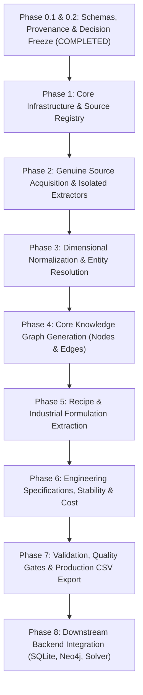

# PHASE 0.1 / 0.2: RECONSTRUCTED PIPELINE ARCHITECTURE & MIGRATION BLUEPRINT

**Document Version:** 2.0.0 (Phase 0.2 Revision)  
**Status:** FROZEN & RATIFIED  
**Scope:** Architectural blueprint for the completely reconstructed Food Formulation Knowledge Graph Preparation Pipeline, incorporating ratified user decisions D-01 through D-05.

---

## 1. Architectural Overview & Design Freeze

The reconstructed pipeline eliminates all synthetic fallback generation, hardcoded factual dictionaries, and modulo relationship synthesis. It replaces the monolithic script (`raw_extractor.py`) with a strictly decoupled 10-stage architecture implemented inside an isolated package (`kg_prep/src/pipeline_v2/`).

```
┌────────────────────────────────────────────────────────────────────────────────────────┐
│                        RECONSTRUCTED 10-STAGE PIPELINE V2                              │
├────────────────────────────────────────────────────────────────────────────────────────┤
│ Stage 1: Source Registry Management       -> config_v2/source_registry.yaml            │
│ Stage 2: Resilient Data Acquisition       -> src/pipeline_v2/acquisition/              │
│ Stage 3: Immutable Raw Storage            -> data/raw/{source}/{version}/ + Manifests  │
│ Stage 4: Dedicated Source Extractors      -> src/pipeline_v2/extractors/{source}/      │
│ Stage 5: Dimensional Normalization        -> src/pipeline_v2/normalization/            │
│ Stage 6: Deterministic Entity Resolution  -> src/pipeline_v2/resolution/               │
│ Stage 7: Canonical Node Generation        -> src/pipeline_v2/graph/node_builder.py     │
│ Stage 8: Verified Relationship Generation -> src/pipeline_v2/graph/relationship_builder│
│ Stage 9: Provenance Ledger Synchronization -> Grounded DuckDB (Analytical Backing)     │
│ Stage 10: Strict Validation & Export      -> data/output_v2/Nodes/ & Relationships/    │
└────────────────────────────────────────────────────────────────────────────────────────┘
```

---

## 2. Incorporation of Ratified User Decisions

1. **USDA Ingestion Scope (Decision D-01)**: Restrict acquisition to **Foundation Foods + SR Legacy** (~10,000 lab-analyzed ingredients, ~60 MB). Branded foods (~380,000 items) are excluded to ensure 100% analytical certitude.
2. **Codex GSFA Provisions (Decision D-02)**: Implement targeted official provision scraping for the core formulation categories: Dairy (01.0), Fats/Oils (02.0), Confectionery (05.0), Cereals (06.0), Bakery (07.0), and Beverages (14.0).
3. **Gated Datasets Handling (Decision D-03)**: Sources requiring institutional credentials or proprietary licenses (Recipe1M+, IFCT 2017, ComBase) are formally registered in `source_registry.yaml` and skipped gracefully with status `AUTHENTICATION_REQUIRED` or `MANUAL_REVIEW_REQUIRED`. Zero mock files or synthetic records are generated.
4. **Missing Values Policy (Decision D-04)**: Strict null safety. Missing nutrients, costs, and properties are stored as `NULL`. No synthetic default constants ($12.50/kg, 150 kcal) and no blind statistical imputation in the production candidate pool.
5. **CSV Column Header Standards (Decision D-05)**: Standard lowercase `snake_case` schema across all output CSVs (`source_id`, `target_id`, `relationship_type`). Legacy dual PascalCase headers are deprecated; backward-compatibility adapters are deferred to Phase 8 backend migration.

---

## 3. Detailed 10-Stage Pipeline Breakdown

### Stage 1: Source Registry Management
- **Module**: `src/pipeline_v2/core/registry.py`
- **Configuration**: `config_v2/source_registry.yaml`
- **Functionality**: Maintains formal metadata, licensing conditions, base URLs, update frequencies, and authentication requirements for all sources.

### Stage 2: Data Acquisition
- **Module**: `src/pipeline_v2/acquisition/`
- **Functionality**: Implements asynchronous chunked streaming for large files, automatic retries with exponential backoff, rate-limit throttles, and resume headers.
- **Strict Invariant**: If a download fails or requires authentication, the collector **never** writes a sample or fallback file. It logs `DOWNLOAD_FAILED` or `AUTHENTICATION_REQUIRED` in `metadata.json` and halts execution for that source branch.

### Stage 3: Raw Data Storage & Cryptographic Manifests
- **Module**: `src/pipeline_v2/core/manifest.py`
- **Storage Target**: `data/raw/{source_name}/{dataset_version}/`
- **Functionality**: Original raw files (OWL ontologies, bulk CSVs, JSON responses, PDF gazettes) are preserved without modification. A cryptographic manifest (`manifest.json` and `download_log.csv`) records the SHA-256 hash, byte size, acquisition timestamp, and source URL for every file.

### Stage 4: Dedicated Source-Specific Extractors
- **Module**: `src/pipeline_v2/extractors/`
- **Structure**: Each source has an isolated, single-responsibility extractor class inheriting from `BaseExtractor`:
  - `foodon_extractor.py`: Parses classes, labels, synonyms, cross-references, and taxonomy using `xml.etree` / RDF parser.
  - `usda_fdc_extractor.py`: Parses USDA bulk CSV tables (`food.csv`, `nutrient.csv`, `food_nutrient.csv`) using streaming chunked reading.
  - `flavordb_extractor.py`: Parses FlavorDB JSON records for odor descriptors, flavor molecules, and botanical source links.
  - `codex_gsfa_extractor.py`: Parses Codex GSFA tables for authorized additive provisions and maximum permissible levels.
  - `openfoodfacts_extractor.py`: Parses commercial product declarations and nutrition labels.
  - `literature_extractor.py`: Parses peer-reviewed PDF papers for hydrocolloid interactions, phase diagrams, and processing parameters.
- **Strict Invariant**: No generic monolithic extraction function. Zero hardcoded ingredient or constraint dictionaries.

### Stage 5: Dimensional Normalization
- **Module**: `src/pipeline_v2/normalization/`
- **Components**:
  - `unit_normalizer.py`: Enforces strict dimensional algebra across mass, concentration, volume, temperature, pressure, viscosity, energy, water activity, and pH. Prohibits dimensional conversions between incompatible physical quantities.
  - `chemical_normalizer.py`: Normalizes chemical identifiers (SMILES, InChIKey, CAS numbers) and IUPAC nomenclature.
  - `category_normalizer.py`: Maps external product categories to standard Codex GSFA food categories.

### Stage 6: Deterministic Entity Resolution
- **Module**: `src/pipeline_v2/resolution/entity_resolver.py`
- **Hierarchy of Resolution**:
  1. Exact Authoritative ID (FoodOn ID, PubChem CID, CAS Number, FDC ID).
  2. Verified Cross-Reference Linkage.
  3. Exact Normalized Name with Compatible Entity Type.
  4. Verified Curated Domain Synonym with Category Agreement.
  5. Scientific Binomial Botanical Name (*e.g., Glycine max*).
  6. Composite Evidence Agreement.
- **Resolution Outcomes**: `RESOLVED_EXACT`, `REVIEW_REQUIRED`, `DISTINCT_NEW_ENTITY`. Ambiguous records are never merged automatically.

### Stage 7: Canonical Node Generation
- **Module**: `src/pipeline_v2/graph/node_builder.py`
- **Functionality**: Generates standardized, schema-compliant node datasets for the frozen canonical node types and reified measurement types. Every node is assigned a deterministic, stable identifier and verified provenance metadata.

### Stage 8: Verified Relationship Generation
- **Module**: `src/pipeline_v2/graph/relationship_builder.py`
- **Functionality**: Generates edges only from explicit source assertions, verified ontology hierarchies, or validated experimental literature.
- **Strict Invariant**: Modulo indexing, arbitrary array slicing, and unverified substring heuristics are eliminated. Every edge specifies an allowed source type, target type, directional relationship, source dataset, and evidence ID.

### Stage 9: Provenance Ledger & Grounded Analytical Sync
- **Module**: `src/pipeline_v2/export/duckdb_exporter.py`
- **Storage**: `data/grounded/grounded_food_knowledge.duckdb`
- **Functionality**: Populates the relational analytical backing store with raw payloads, normalized records, field-level provenance, entity resolution mappings, conflict logs, and execution manifests.

### Stage 10: Strict Validation & Production Export
- **Module**: `src/pipeline_v2/validation/`
- **Quality Gates**:
  - `schema_validator.py`: Asserts non-null primary keys, valid foreign key references, and correct column types.
  - `integrity_checker.py`: Identifies and rejects dangling or orphan edges.
  - `synthetic_detector.py`: Scans generated datasets for uniform distributions, modulo sequences, or ungrounded claims.
  - `connectivity.py`: Evaluates graph reachability, diameter, and connected component metrics.
- **Status Reporting**: Pipeline status evaluates to `PASS`, `PASS_WITH_WARNINGS`, `FAIL`, or `NOT_VERIFIED`. A run with missing mandatory sources or referential integrity errors cannot report `PASS`.

---

## 4. Reordered Implementation Dependencies


