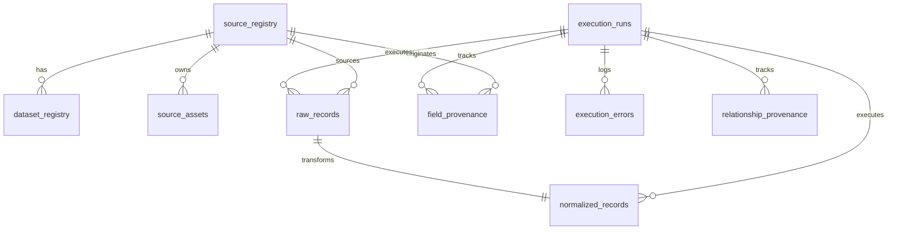

# PHASE 1: DUCKDB RELATIONAL DATABASE SCHEMA SPECIFICATION

**Document Version:** 1.0.0  
**Phase:** Phase 1 Infrastructure & Provenance Storage  
**Database Engine:** DuckDB 1.5.5+  
**Target Storage File:** `data/intermediate_v2/kg_staging.duckdb` (or `:memory:` during testing)  
**Schema Status:** INITIALIZED & TEST-VERIFIED  

---

## 1. Overview & Architectural Role

DuckDB is deployed as the **local relational staging, caching, execution-tracking, and fine-grained provenance engine** for Knowledge Graph Preparation Pipeline V2.

DuckDB is **not** the graph database itself; canonical export targets CSV files for Neo4j ingestion in Phase 7. DuckDB ensures:
1. Strict relational staging of raw ingested records before transformation.
2. Complete field-level traceability (`field_provenance`) from source table column to target node attribute.
3. Complete relationship-level traceability (`relationship_provenance`) connecting every graph edge to its source evidence.
4. ACID transactions with safe rollback upon any extraction or validation failure.
5. Zero synthetic or fabricated records in storage.

---

## 2. Table Specifications (10 Versioned Core Tables)

### Table 1: `schema_versions`
Tracks database schema migrations and versions.

```sql
CREATE TABLE schema_versions (
    version_id VARCHAR PRIMARY KEY,
    installed_at TIMESTAMP WITH TIME ZONE DEFAULT CURRENT_TIMESTAMP,
    description VARCHAR
);
```

### Table 2: `source_registry`
Persists declarative source integration definitions synchronized from `config_v2/source_registry.yaml`.

```sql
CREATE TABLE source_registry (
    source_id VARCHAR PRIMARY KEY,
    source_name VARCHAR NOT NULL,
    authority VARCHAR NOT NULL,
    source_type VARCHAR NOT NULL,
    base_url VARCHAR NOT NULL,
    endpoint VARCHAR,
    access_method VARCHAR NOT NULL,
    expected_format VARCHAR NOT NULL,
    authentication_required BOOLEAN NOT NULL,
    license_reference VARCHAR NOT NULL,
    dataset_version VARCHAR,
    enabled BOOLEAN NOT NULL,
    access_status VARCHAR NOT NULL,
    parser_identifier VARCHAR NOT NULL,
    notes VARCHAR,
    registered_at TIMESTAMP WITH TIME ZONE DEFAULT CURRENT_TIMESTAMP
);
```

### Table 3: `dataset_registry`
Tracks specific snapshot releases of registered sources.

```sql
CREATE TABLE dataset_registry (
    dataset_id VARCHAR PRIMARY KEY,
    source_id VARCHAR NOT NULL REFERENCES source_registry(source_id),
    dataset_version VARCHAR NOT NULL,
    release_date VARCHAR,
    sha256_hash VARCHAR,
    download_url VARCHAR,
    record_count BIGINT,
    registered_at TIMESTAMP WITH TIME ZONE DEFAULT CURRENT_TIMESTAMP
);
```

### Table 4: `source_assets`
Maintains cryptographic provenance and disk paths for all acquired files.

```sql
CREATE TABLE source_assets (
    asset_id VARCHAR PRIMARY KEY,
    source_id VARCHAR NOT NULL REFERENCES source_registry(source_id),
    dataset_id VARCHAR NOT NULL,
    original_filename VARCHAR NOT NULL,
    local_path VARCHAR NOT NULL,
    source_url VARCHAR NOT NULL,
    dataset_version VARCHAR NOT NULL,
    downloaded_at TIMESTAMP WITH TIME ZONE NOT NULL,
    file_size_bytes BIGINT NOT NULL,
    sha256 VARCHAR(64) NOT NULL,
    content_type VARCHAR NOT NULL,
    access_status VARCHAR NOT NULL,
    integrity_status VARCHAR NOT NULL,
    metadata_json JSON
);
```

### Table 5: `execution_runs`
Tracks execution pipeline runs across each processing stage.

```sql
CREATE TABLE execution_runs (
    execution_id VARCHAR PRIMARY KEY,
    stage_name VARCHAR NOT NULL,
    status VARCHAR NOT NULL,
    started_at TIMESTAMP WITH TIME ZONE NOT NULL,
    completed_at TIMESTAMP WITH TIME ZONE,
    total_records_processed BIGINT DEFAULT 0,
    total_records_failed BIGINT DEFAULT 0,
    pipeline_version VARCHAR NOT NULL,
    parameters_json JSON,
    summary_metrics_json JSON
);
```

### Table 6: `execution_errors`
Logs structured errors, stack traces, and affected records.

```sql
CREATE TABLE execution_errors (
    error_id VARCHAR PRIMARY KEY,
    execution_id VARCHAR NOT NULL REFERENCES execution_runs(execution_id),
    stage_name VARCHAR NOT NULL,
    source_id VARCHAR,
    record_identifier VARCHAR,
    error_type VARCHAR NOT NULL,
    error_message VARCHAR NOT NULL,
    error_details_json JSON,
    occurred_at TIMESTAMP WITH TIME ZONE NOT NULL
);
```

### Table 7: `raw_records`
Staging table for raw extracted entity records prior to normalization.

```sql
CREATE TABLE raw_records (
    raw_record_id VARCHAR PRIMARY KEY,
    source_id VARCHAR NOT NULL REFERENCES source_registry(source_id),
    dataset_id VARCHAR NOT NULL,
    native_record_id VARCHAR NOT NULL,
    asset_id VARCHAR NOT NULL,
    payload_json JSON NOT NULL,
    extracted_at TIMESTAMP WITH TIME ZONE NOT NULL,
    execution_id VARCHAR NOT NULL REFERENCES execution_runs(execution_id)
);
```

### Table 8: `normalized_records`
Staging table for normalized records conforming to domain entity schemas.

```sql
CREATE TABLE normalized_records (
    normalized_record_id VARCHAR PRIMARY KEY,
    raw_record_id VARCHAR NOT NULL REFERENCES raw_records(raw_record_id),
    target_entity_type VARCHAR NOT NULL,
    canonical_entity_id VARCHAR NOT NULL,
    normalized_payload_json JSON NOT NULL,
    normalization_status VARCHAR NOT NULL,
    normalized_at TIMESTAMP WITH TIME ZONE NOT NULL,
    execution_id VARCHAR NOT NULL REFERENCES execution_runs(execution_id)
);
```

### Table 9: `field_provenance`
Fine-grained attribute-level lineage mapping target fields to source fields.

```sql
CREATE TABLE field_provenance (
    provenance_id VARCHAR PRIMARY KEY,
    execution_id VARCHAR NOT NULL REFERENCES execution_runs(execution_id),
    target_table VARCHAR NOT NULL,
    target_entity_id VARCHAR NOT NULL,
    target_field_name VARCHAR NOT NULL,
    source_id VARCHAR NOT NULL REFERENCES source_registry(source_id),
    source_dataset_id VARCHAR NOT NULL,
    source_record_id VARCHAR NOT NULL,
    source_field_name VARCHAR NOT NULL,
    raw_value VARCHAR,
    normalized_value VARCHAR,
    transformation_rule VARCHAR,
    extraction_confidence DOUBLE NOT NULL,
    created_at TIMESTAMP WITH TIME ZONE NOT NULL
);
```

### Table 10: `relationship_provenance`
Lineage table for every relationship edge created in the graph.

```sql
CREATE TABLE relationship_provenance (
    relationship_id VARCHAR PRIMARY KEY,
    execution_id VARCHAR NOT NULL REFERENCES execution_runs(execution_id),
    relationship_type VARCHAR NOT NULL,
    source_node_id VARCHAR NOT NULL,
    source_node_type VARCHAR NOT NULL,
    target_node_id VARCHAR NOT NULL,
    target_node_type VARCHAR NOT NULL,
    source_dataset_id VARCHAR NOT NULL,
    source_record_id VARCHAR NOT NULL,
    extraction_confidence DOUBLE NOT NULL,
    evidence_id VARCHAR,
    verification_status VARCHAR NOT NULL,
    is_derived BOOLEAN NOT NULL,
    created_at TIMESTAMP WITH TIME ZONE NOT NULL
);
```

---

## 3. Referential Integrity and Constraint Graph


