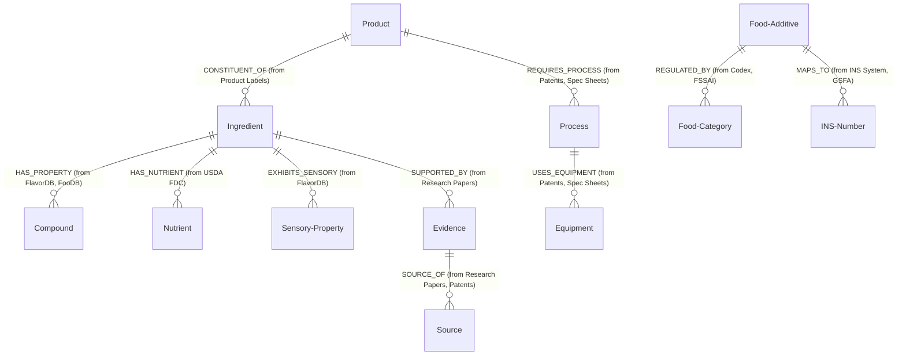

# Raw Datasets Exploratory Guide — Food Formulation KG

This document profiles the raw data files currently present in the data repository, outlining file counts, sizes, structural schemas, and the extraction strategy for building the Food Formulation Knowledge Graph.

---

## 1. Directory Inventory Summary

The table below shows the exact file counts and sizes of the raw datasets currently organized in the `data/` directory:

| Domain Directory | Subdirectory | File Count | Total Size | Primary Formats | Content Description |
| :--- | :--- | :---: | :---: | :---: | :--- |
| **Structured** | `structured/foodb` | 1 | 0.53 KB | ZIP (CSV) | FooDB compound database fallback (contains 5 compounds). |
| **Structured** | `structured/usda_fdc` | 1 | 0.25 KB | ZIP (CSV) | USDA FoodData Central fallback (contains 3 food records). |
| **Structured** | `structured/recipe1m` | 0 | 0.00 KB | JSON | *Manual Download Required* (instructions in README). |
| **Structured** | `structured/nutrition5k` | 0 | 0.00 KB | JSON | *Manual Download Required* (instructions in README). |
| **Structured** | `structured/gsfa_xml` | 0 | 0.00 KB | XML | *Manual Download Required* (instructions in README). |
| **Semi-Structured** | `semi_structured/flavordb` | 41 | 3,533.60 KB | HTML, JSON | 1 home HTML, 20 detail HTMLs, 20 ingredient profile JSONs. |
| **Semi-Structured** | `semi_structured/gsfa_html` | 4 | 48.98 KB | HTML | Codex GSFA online page scrapes (home, categories, additives, INS). |
| **Semi-Structured** | `semi_structured/product_labels` | 4 | 392.16 KB | HTML | Open Food Facts product label HTML pages (Nutella, Coke, etc.). |
| **Semi-Structured** | `semi_structured/specification_sheets` | 5 | 228.14 KB | HTML, TXT | Scraped product lists and spec templates (Cargill, Ingredion, etc.). |
| **Unstructured** | `unstructured/ins` | 1 | 45.86 KB | PDF | Codex Class Names & INS Numbering System PDF (CXG 36-1989). |
| **Unstructured** | `unstructured/codex` | 1 | 46.10 KB | PDF | Codex General Standard for Food Additives PDF (CXS 192-1995). |
| **Unstructured** | `unstructured/fssai` | 1 | 0.39 KB | TXT | Indian FSSAI Food Additives Regulations standard placeholder. |
| **Unstructured** | `unstructured/research_papers`| 3 | 1,782.30 KB | PDF | 3 full-text Open Access arXiv papers on food stabilization. |
| **Unstructured** | `unstructured/patents` | 3 | 1.56 KB | TXT | Patent document placeholders for food formulations. |
| **Ontology** | `ontology/` | 1 | 40,429.97 KB | OWL (XML) | *FoodOn Ontology* (`foodon.owl`) copied from pipeline scratch. |
| **Root Metadata** | `data/` | 2 | 26.99 KB | JSON, CSV | Master metadata catalog (`metadata.json`) & `download_log.csv`. |
| **TOTAL** | — | **68** | **46,508.83 KB** | — | **~45.42 MB total data lake footprint.** |

---

## 2. Dataset Schema & Extraction Matrix

The table below explains what raw information exists in each dataset, what semantic fields we will extract, and how we will utilize them:

| Source Dataset | Key Fields / Data Elements | Candidate KG Nodes (Entities) | Candidate KG Relationships (Edges) | How We Will Utilize This in the Graph |
| :--- | :--- | :--- | :--- | :--- |
| **FooDB** | `id`, `name`, `chemical_formula`, `cas_number`, `molecular_weight`, `solubility`, `ph`, `functional_role` | `Ingredient`, `Compound`, `Property`, `FunctionalRole` | `Ingredient` $\rightarrow$ `Compound` `Compound` $\rightarrow$ `Property` | Map ingredients to their chemical molecules and properties (solubility/pH) to query molecular behavior. |
| **USDA FDC** | `fdc_id`, `description`, `dataType`, `publication_date`, nutrient metrics (`value`, `unitName`) | `Ingredient`, `Nutrient`, `FoodCategory` | `Ingredient` $\rightarrow$ `Nutrient` `Ingredient` $\rightarrow$ `FoodCategory` | Define nutritional profiles of raw formulation ingredients for calorie and macro-nutrient calculations. |
| **FlavorDB** | `entity_id`, `flavor_molecules` (`molecule_name`, `pubchem_cid`), `odor_descriptors` | `Ingredient`, `Compound`, `SensoryProperty` | `Ingredient` $\rightarrow$ `Compound` `Compound` $\rightarrow$ `SensoryProperty` | Map chemical compounds to human odor/taste perceptions (e.g., vanilla odor profile) to predict flavor pairings. |
| **Product Labels** | `product_name`, `brands`, `categories`, `ingredients_text` | `Product`, `Brand`, `FoodCategory`, `Ingredient` | `Product` $\rightarrow$ `Ingredient` `Product` $\rightarrow$ `Brand` | Extract the ingredients list of commercial products to identify matches with standard additives and nutrients. |
| **GSFA Online** | Food additive entries, INS numbers, category tables, ML restrictions | `FoodAdditive`, `INSNumber`, `FoodCategory`, `Regulation` | `FoodAdditive` $\rightarrow$ `INSNumber` `FoodAdditive` $\rightarrow$ `FoodCategory` | Map legal standards to specific food categories to evaluate additive compliance. |
| **Product Spec Sheets** | Manufacturer profiles, specification parameters (moisture, purity, viscosity) | `Manufacturer`, `Equipment`, `Property` | `Manufacturer` $\rightarrow$ `Ingredient` `Ingredient` $\rightarrow$ `Property` | Establish manufacturer profiles and physical ingredient limits for processing models. |
| **INS Numbering** | INS Codes (e.g., `100(i)`), additive names, functional classes | `FoodAdditive`, `INSNumber`, `FunctionalRole` | `FoodAdditive` $\rightarrow$ `INSNumber` `FoodAdditive` $\rightarrow$ `FunctionalRole` | Standardize naming conventions between regulatory PDFs and scraped web data. |
| **Codex Standards** | Maximum levels (ML) in mg/kg, food categories, regulatory status | `Regulation`, `FoodCategory`, `FoodAdditive` | `FoodAdditive` $\rightarrow$ `Regulation` `Regulation` $\rightarrow$ `FoodCategory` | Enforce compliance limits in formulation models (e.g., alert if Curcumin exceeds 500 mg/kg in cheese). |
| **Research Papers** | Scientific paragraphs, abstracts, and citations on emulsifiers/hydrocolloids | `Process`, `Ingredient`, `Evidence` | `Ingredient` $\rightarrow$ `Process` `Ingredient` $\rightarrow$ `Evidence` | Provide scientific backing (evidence) for physical properties and process parameters (e.g., viscosity changes). |
| **Patents** | Patent abstract, disclosures, process speeds, extrusion parameters | `Process`, `Equipment`, `Evidence`, `Source` | `Product` $\rightarrow$ `Process` `Process` $\rightarrow$ `Equipment` | Map manufacturing parameters (e.g. twin-screw extrusion parameters) to product classes. |
| **FoodOn Ontology** | OWL RDF triples, subclass relationships, entity hierarchies | `FoodCategory`, `Process`, `Equipment` | `FoodCategory` $\rightarrow$ `FoodCategory` (SubclassOf) | Establish hierarchy trees for food categories and industrial operations. |

---

## 3. Knowledge Graph Target Schema mapping

The diagram below details the target Knowledge Graph schema and shows which raw sources will populate each node and relationship:

