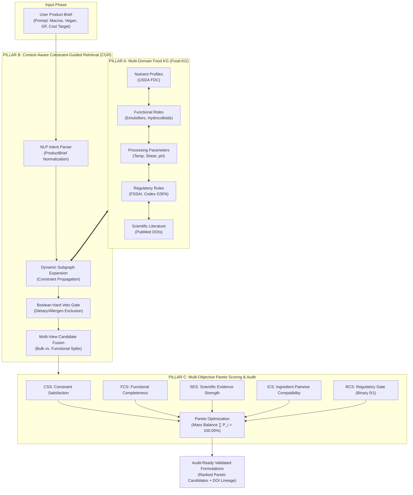

# System Architecture & Novelty Framework: Explainable AI Food Formulation Platform

## Executive Summary & Novelty Positioning

While recent SOTA frameworks in knowledge graphs and RAG (2024–2026) address isolated sub-problems—such as general recipe-nutrient linking (*SwissFKG*, Rahman 2025), multi-hop QA constraint filtering (*AF-Retriever*, Gao et al. 2025), or materials design subgraphs (*GraphAgents*, Wei et al. 2026)—**our platform is the first end-to-end Explainable AI system that unifies dynamic constraint-guided graph traversal, multi-view candidate recipe fusion, and evidence-grounded multi-objective formulation scoring for industrial food design.**

---

## Key Technical Pillars & Novelty Claims

### (A) Multi-Domain Food Knowledge Graph (Food-KG)

> [!NOTE]
> **Novelty vs. Prior Art (*SwissFKG* 2025, *FoodKG*)**: Prior food KGs map static recipe-to-ingredient and basic nutrient triples, but completely omit technological functional roles (e.g. gelation mechanism), processing sensitivities (e.g. thermal denaturation threshold), and explicit literature provenance.

1. **Multidomain Unified Ontology**: Encodes relationships across 6 distinct food domains: `Ingredient`, `Nutrient`, `FunctionalRole`, `ProcessingCondition`, `RegulatoryRule`, and `EvidenceNode`.
2. **Explicit Property Linkage**: Supports dynamic multi-hop Cypher queries such as:
   $$\text{MATCH } (i:\text{Ingredient})-[:\text{PERFORMS\_ROLE}]->(r:\text{FunctionalRole \{name: 'Emulsifier'\}})$$
   $$\text{WHERE } i.\text{vegan} = \text{true } \text{AND } i.\text{gluten\_free} = \text{true}$$
3. **Literature Provenance & Evidence Nodes**: Links ingredient claims to PubMed DOIs, USDA FDC IDs, and FSSAI Schedule II additive thresholds.

---

### (B) Context-Aware Constraint-Guided Retrieval (CGR)

> [!TIP]
> **Novelty vs. Prior Art (*AF-Retriever* 2025, *DCTR* 2026, *Think-Then-Rewrite* 2026)**: Rather than performing standard unconstrained vector search or generic graph RAG, our retriever treats user constraints as active traversal filters during graph expansion, generating multi-ingredient combinations directly.

1. **Constraint-Driven Subgraph Pruning**: Hard boolean filters ($Veto_d, Veto_a$) prune ineligible branches *before* candidate generation:
   $$\text{EligiblePool} = \{ i \in V_{KG} \mid Veto_{\text{vegan}}(i) \land Veto_{\text{gluten\_free}}(i) \land Veto_{\text{allergen}}(i) = \text{True} \}$$
2. **Hybrid Multi-Strategy Retrieval**: Combines Cypher multi-hop graph traversal, DuckDB/SQLite relational fact retrieval, and 384-dimensional dense vector search (`sentence-transformers/all-MiniLM-L6-v2`) in parallel.
3. **Multi-View Candidate Recipe Fusion**: Fuses retrieved entities into cohesive bulk and functional ingredient splits that satisfy deterministic mass balance:
   $$\sum_{k=1}^{N} P_k = 100.00\%$$

---

### (C) Multi-Objective Scoring & Audit Framework

> [!IMPORTANT]
> **Novelty vs. Prior Art (*Tang et al.* 2026, *IISS*)**: Existing optimizers evaluate only macro nutrition vs unit cost. Our framework introduces **FCS** (Functional Completeness Score), **SES** (Scientific Evidence Strength), **ICS** (Pairwise Ingredient Compatibility), and **RCS** (Binary Regulatory Gate).

1. **Functional Completeness Score (FCS)**:
   $$\text{FCS} = \frac{\sum_{r \in R_{\text{required}}} \mathbb{I}(r \in \text{RecipeRoles})}{|R_{\text{required}}|} \times 100$$
2. **Scientific Evidence Strength (SES)**:
   $$\text{SES} = \sum_{k=1}^{N} \left( \frac{P_k}{100} \times \frac{|\text{DOICitations}_k|}{|\text{DOICitations}_k| + 1} \right) \times 100$$
3. **Ingredient Pairwise Compatibility Score (ICS)**:
   $$\text{ICS} = 100 - \sum_{(i, j) \in \text{Pairs}} \text{ConflictPenalty}(i, j)$$
4. **Regulatory Compliance Gate (RCS)**:
   $$\text{RCS} = \prod_{k=1}^{N} \mathbb{I}(P_k \le \text{FSSAI\_Limit}_k) \in \{0, 1\}$$
5. **Overall Pareto Score**:
   $$S_{\text{Total}} = \text{RCS} \times \left( w_m S_{\text{Macro}} + w_c S_{\text{Cost}} + w_f \text{FCS} + w_e \text{SES} + w_i \text{ICS} \right)$$

---

## Comparative Matrix: SOTA Frameworks (2024–2026)

| Feature / Metric | Our Platform (2026) | GraphAgents (Wei 2026) | DCTR (Mar 2026) | AF-Retriever (May 2025) | SwissFKG (Jul 2025) |
| :--- | :---: | :---: | :---: | :---: | :---: |
| **Domain Scope** | **Food Formulation** | Materials Science | General KG QA | Multi-hop QA | General Recipe KG |
| **Dynamic Subgraph Construction** | **Yes (Constraint-Driven)** | Yes (Multi-Agent) | Yes (Dual-Constraint) | No (Static Graph) | No (Monolithic Graph) |
| **Functional Role Encoding** | **Yes (Emulsifiers, Hydrocolloids)** | No | No | No | No |
| **Multi-Ingredient Recipe Fusion** | **Yes ($\sum P_i = 100\%$)** | Yes (Materials) | No | No | No |
| **Evidence Lineage (DOIs / FSSAI)** | **Yes (SES Metric)** | No | No | No | No |
| **Regulatory Gate (RCS)** | **Yes (Binary 0/1 Veto)** | No | No | No | Partial (Static Allergen) |
| **Pairwise Compatibility (ICS)** | **Yes (Chemical & pH)** | No | No | No | No |

---

## Validation & Ablation Protocols

1. **Ablation Study 1 (Constraint Propagation)**: Measure drop in candidate feasibility when disabling early graph pruning vs post-hoc filtering.
2. **Ablation Study 2 (FCS & SES Scoring)**: Evaluate formulation texture success and empirical literature backing when FCS and SES metrics are removed from Pareto ranking.
3. **Retrieval Precision & Hypervolume**: Compute Pareto front coverage quality (Hypervolume metric) against standard NSGA-II baseline optimizers.
